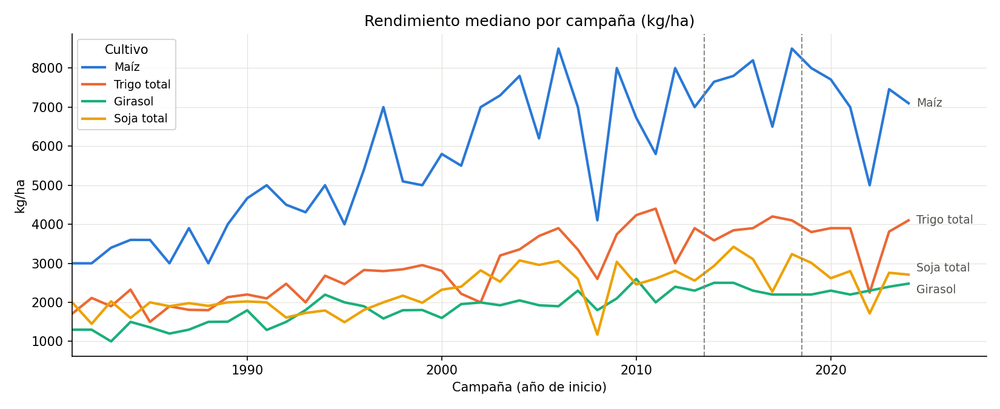
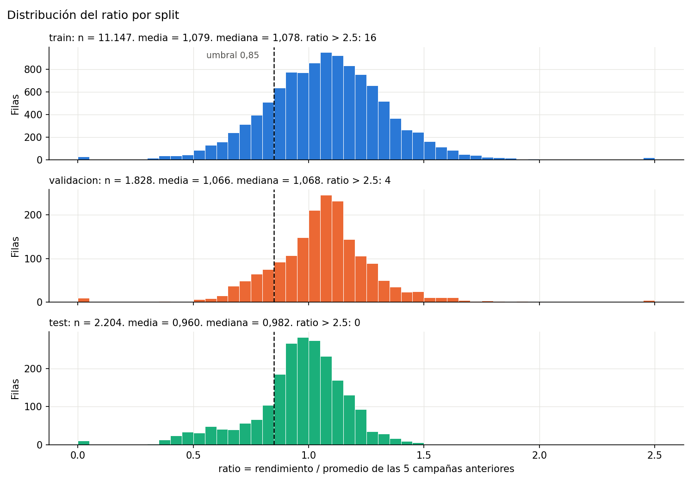
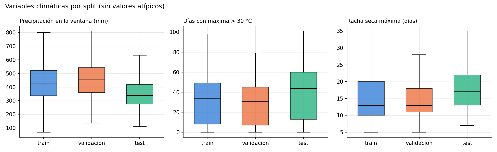

# Entrega 2: preparación de datos y baselines

**TP Integrador de Aprendizaje Automático**  
**Proyecto:** rendimiento de cultivos por partido en la Provincia de Buenos Aires  
**Repositorio:** https://github.com/GalvanAlexis/tp-integrador-rendimiento-cultivos

## Datos del trabajo

| Dato | Completar |
|---|---|
| Integrantes | Francisco Calahorra, Federico Valdés, Alexis Galván |
| Curso | Aprendizaje Automático 2026 |
| Fecha de inicio | 13/10/2026 |
| Fecha de entrega | dd/mm/aaaa |

---

## Resumen ejecutivo

La Entrega 2 deja preparado el dataset de trabajo, el diccionario de variables, la definición de los objetivos, el protocolo de evaluación y los dos baselines obligatorios.

El dataset final tiene **15.179 filas** de modelado: 11.147 para entrenamiento, 1.828 para validación y 2.204 para prueba. La clase positiva, campaña mala con umbral 85%, representa el **18,0%** en train, **14,8%** en validación y **21,3%** en test.

El baseline más fuerte no es el Dummy: es el **promedio de las cinco campañas anteriores**. En test alcanza un MAE de **0,154** en el ratio y **626 kg/ha**, y supera al Dummy, que se queda con la media del train. Sin embargo, los dos baselines tienen **recall = 0**: no detectan ninguna campaña mala. Es el ejemplo concreto de que un MAE razonable no garantiza una buena clasificación.

La campaña **2022/23** concentra el **60,7%** de los casos malos del test. El modelo de la Clase 3 tendrá que demostrar que puede detectarla con variables climáticas.

Se encontraron **12 ratios extremos** (mayores a 3). Todos tienen la misma causa: campañas sin cosecha entre las cinco anteriores, que bajan el promedio. Se conservan y se agrega `prev5_ceros` como predictor.

El umbral 0,85 se justifica contra dos referencias externas, la Ley 26.509 de Emergencia Agropecuaria y el seguro multirriesgo, y contra la tasa de positivos que deja en train (18%).

---

## 1. Problema y decisión

### 1.1 Problema

Los productores y asesores agronómicos deben tomar decisiones antes de la cosecha: contratar cobertura, vender a futuro, gestionar financiamiento o priorizar asistencia. El rendimiento de la campaña todavía no se conoce y el clima es una de las principales fuentes de variación.

### 1.2 Usuario

Productores, asesores agronómicos, cooperativas, aseguradoras, bancos agropecuarios y áreas de producción de los municipios.

### 1.3 Decisión

Contratar o reforzar una cobertura de seguro, vender de forma anticipada una parte de la cosecha, gestionar financiamiento y priorizar asistencia en los partidos con alerta.

### 1.4 Momento de la predicción

La predicción se hace en una fecha de corte fija por cultivo, al final del período crítico y antes de la cosecha:

| Cultivo | Ventana climática | Corte | Qué cubre el corte |
|---|---|---|---|
| Trigo | 01/06 a 15/11 | 15/11 | Espigazón y floración, que son el período crítico del trigo, en la mayor parte de la provincia |
| Maíz | 01/09 a 31/01 | 31/01 | La floración de los maíces de siembra temprana, que ocurre entre diciembre y enero |
| Girasol | 01/09 a 31/01 | 31/01 | La floración de las siembras de primavera |
| Soja | 01/11 a 28/02 | 28/02 | El inicio de R3–R6, la etapa en que se define el número de granos |

Solo se usan datos disponibles hasta esa fecha.

**Criterio.** El corte se ubica cuando el período crítico de cada cultivo ya empezó para las fechas de siembra típicas. En ese momento el clima ya explica buena parte del resultado y todavía falta la cosecha, así que hay tiempo para decidir. Es un compromiso entre anticipación e información: cortar antes da más tiempo, pero el modelo ve menos clima.

En soja, el número de granos se define principalmente entre R3 y R6 (Monzón et al., 2021). En trigo, el período crítico coincide con la espigazón y la floración (CRONOGEN-Trigo, FAUBA e INTA). Las fuentes están en el Anexo C.

**Limitación.** Las fechas son únicas para toda la provincia. El sur siembra y florece más tarde que el norte, y el maíz tardío o la soja de segunda florecen después del corte. En esos casos, la ventana captura solo una parte del período crítico. Un corte por zona o por fecha de siembra queda como mejora posible.

---

## 2. Datos

### 2.1 Fuente

**Estimaciones Agrícolas**, Datos Abiertos de la Provincia de Buenos Aires.

- Organismo: Ministerio de Economía. Secretaría de Agricultura, Ganadería y Pesca. Dirección de Estimaciones Agrícolas.
- Cobertura: campañas 1969/70 a 2025/26.
- Licencia: CC BY 4.0.
- Catálogo: https://catalogo.datos.gba.gob.ar/dataset/estimaciones-agro
- Archivo: `datos/raw/estimaciones-agricolas-1969_2026.csv`
- SHA-256: `a3b8e1295978343847324b2c3dff4d41b985f093372b34b1290cbc7ad75934e0`

El clima se obtiene de **NASA POWER**, con datos diarios desde 1981 y una grilla de aproximadamente 0,5°.

### 2.2 Cobertura y calidad

| Control | Resultado |
|---|---|
| Filas totales | 53.905 |
| Cultivos | 31 |
| Municipios | 152 nombres, incluido "Ignorado" |
| Campañas | 57 |
| Duplicados por cultivo, campaña y municipio | 0 |
| Superficie cosechada mayor que sembrada | 0 casos |
| Consistencia rendimiento vs producción / cosechada | Diferencia menor al 1% |
| Rendimiento negativo o superficie sembrada no positiva | 1 y 2 filas, eliminadas |
| Ratio mayor a 3 (valor sospechoso) | 12 filas, conservadas y documentadas (sección 2.7) |
| Faltantes en el dataset de modelado | 0 |
| Chascomús | Tiene registros en los cuatro cultivos del alcance |

La consistencia interna del archivo es alta. El trabajo de preparación está, sobre todo, en la selección de cultivos, el tratamiento de los ceros, la construcción del promedio histórico y la unión con el clima.

### 2.3 Limpieza

| Paso | Filas antes | Filas después | Removidas | Motivo |
|---|---:|---:|---:|---|
| Lectura del CSV | 53.905 | 53.905 | 0 | Archivo original |
| Filtrar cultivos | 53.905 | 20.495 | 33.410 | Maíz, trigo total, girasol y soja total |
| Filtrar campañas | 20.495 | 20.393 | 102 | Se excluye 2025/26 por incompleta |
| Quitar "Ignorado" | 20.393 | 20.393 | 0 | Sin partido asignado en estos cultivos |
| Quitar rendimiento inválido | 20.393 | 20.392 | 1 | Nulo o negativo |
| Quitar superficie inválida | 20.392 | 20.390 | 2 | Sembrada nula o no positiva |
| Quitar duplicados | 20.390 | 20.390 | 0 | Sin duplicados |
| Dataset de modelado | 20.390 | 15.179 | 5.211 | Fuera de 1981-2024 o sin 5 campañas previas |

El dataset de modelado conserva **15.179 filas**. La diferencia con las 20.390 filas limpias corresponde a campañas anteriores a 1981 y a filas que no tienen cinco campañas calendario previas con dato.

### 2.4 Decisiones sobre los ceros

Hay rendimientos cero en los cuatro cultivos del alcance:

| Cultivo | Filas con rendimiento 0 | Porcentaje del cultivo |
|---|---:|---:|
| Maíz | 109 | 2,5% |
| Soja total | 58 | 1,5% |
| Trigo total | 18 | 0,4% |
| Girasol | 3 | 0,07% |

En todos los casos, `superficie_cosechada = 0`. Se interpretan como **campaña sin cosecha**, no como un rendimiento medido. Se conservan como casos de pérdida total porque son justamente los casos más costosos para el usuario. En el dataset de modelado son pocos: 27 en train, 9 en validación y 10 en test.

### 2.5 Variables

El diccionario completo está en `datos/diccionario_variables.md`. Las variables principales son:

- `cultivo`, `municipio_id`, `campania_inicio`, `superficie_sembrada`;
- `prev5`: promedio de las cinco campañas anteriores;
- `prev5_ceros`: cuántas de esas cinco campañas no tuvieron cosecha;
- variables climáticas agregadas hasta la fecha de corte;
- `ratio`: rendimiento relativo;
- `mala85`: clase binaria.

No se usan `produccion` ni `superficie_cosechada` porque el rendimiento se calcula a partir de ellas. Tampoco se usa clima posterior al corte ni el promedio de campañas futuras.

### 2.6 Distribuciones

**Rendimiento.** El rendimiento mediano crece en los cuatro cultivos entre 1981-1985 y 2020-2024: maíz ×2,06, trigo ×1,88, girasol ×1,81 y soja ×1,39. Un modelo entrenado en kg/ha con datos hasta 2013 tendría que extrapolar esa tendencia. Es el motivo principal para modelar el ratio.



**Ratio.** Está centrado cerca de 1, con una cola izquierda (campañas malas) y una cola derecha larga y poco poblada.

| Split | Media | Mediana | P25 | P75 | Máximo |
|---|---:|---:|---:|---:|---:|
| Train | 1,079 | 1,078 | 0,910 | 1,238 | 10,000 |
| Validación | 1,066 | 1,068 | 0,944 | 1,171 | 10,294 |
| Test | 0,960 | 0,982 | 0,874 | 1,086 | 2,174 |



El test está corrido a la izquierda: es un período más malo que el de entrenamiento. Las 46 campañas sin cosecha quedan en ratio 0.

**Predictores.** Las escalas son muy distintas. En train, la superficie sembrada va de 8 a 364.791 ha, con mediana de 10.000 ha y una cola derecha muy larga; `prev5` va de 180 a 9.547 kg/ha. KNN necesita el `StandardScaler` dentro del Pipeline, y conviene evaluar el logaritmo de la superficie.

**Clima.** El período de test fue más seco y más caluroso que el de train: menos precipitación en la ventana, más días con máxima mayor a 30 °C y rachas secas más largas.



Las correlaciones de Spearman con el ratio, calculadas solo con train, muestran una diferencia fuerte entre cultivos:

| Variable | Maíz | Trigo | Girasol | Soja |
|---|---:|---:|---:|---:|
| Precipitación en la ventana | +0,36 | −0,06 | +0,01 | +0,42 |
| Días con máxima > 30 °C | −0,31 | −0,07 | 0,00 | −0,25 |
| Humedad media | +0,25 | −0,05 | +0,05 | +0,33 |
| Racha seca máxima | −0,18 | −0,13 | −0,03 | −0,16 |

En maíz y soja el clima tiene la relación esperada con el rendimiento. En trigo y girasol las correlaciones son casi nulas. Es una advertencia para la Clase 3: con estas variables, el clima puede aportar poco en esos dos cultivos.

### 2.7 Ratios extremos

Hay 12 filas con ratio mayor a 3: 10 en train, 2 en validación y ninguna en test. El caso más alto es maíz 2016/17 en Coronel de Marina L. Rosales, con un ratio de 10,3. Cuatro de las cinco campañas anteriores tienen rendimiento 0, el promedio queda en 680 kg/ha y la cosecha fue de 7.000 kg/ha.

Los 12 casos tienen al menos una campaña sin cosecha entre las cinco anteriores. Son partidos donde el cultivo era marginal y muchos años se sembraba sin cosechar.

| Ceros en las 5 campañas previas | Filas | Ratio medio | Ratio máximo |
|---:|---:|---:|---:|
| 0 | 14.989 | 1,055 | 2,691 |
| 1 | 120 | 1,279 | 3,529 |
| 2 | 36 | 1,075 | 3,333 |
| 3 | 23 | 1,762 | 3,457 |
| 4 | 11 | 4,448 | 10,294 |

**Decisión:**

1. Se conservan las filas. El rendimiento actual es consistente con producción y superficie, así que no es un error de carga. Eliminarlas sería elegir casos según el objetivo.
2. Se agrega `prev5_ceros` como predictor. Usa solo campañas anteriores, está disponible al predecir y permite que el modelo reconozca estos casos.
3. La lista queda en `datos/procesado/casos_ratio_extremo.csv`.
4. No se agrega una columna "es extremo": se calcula con el objetivo y sería fuga.
5. El MAE es la métrica principal de regresión.

Sensibilidad en validación:

| Filas | Modelo | n | MAE ratio | RMSE ratio |
|---|---|---:|---:|---:|
| Todas | Dummy | 1.828 | 0,1645 | 0,3162 |
| Todas | Promedio 5 | 1.828 | 0,1758 | 0,3229 |
| Sin ceros previos | Dummy | 1.799 | 0,1524 | 0,2098 |
| Sin ceros previos | Promedio 5 | 1.799 | 0,1631 | 0,2167 |

Al quitar 29 filas, el RMSE baja un 34% y el MAE un 7%. El RMSE depende mucho de pocos casos; por eso se reporta como complemento del MAE.

---

## 3. Objetivos

### 3.1 Regresión

Predecir el rendimiento relativo:

```text
ratio = rendimiento / promedio de las 5 campañas anteriores
```

La predicción se convierte a kg/ha multiplicando por `prev5`. Se modela el ratio y no el rendimiento absoluto por tres razones:

1. Es comparable entre cultivos y partidos.
2. Es más estacionario: absorbe la tendencia tecnológica y las diferencias de suelo.
3. Evita que un árbol tenga que extrapolar una tendencia que no puede ver.

### 3.2 Clasificación

```text
campaña_mala = 1 si ratio < 0,85
```

La clase positiva es la campaña mala. El umbral principal es 0,85; 0,80 y 0,90 se analizan como sensibilidad.

### 3.3 Justificación del umbral

El umbral es relativo al promedio de las cinco campañas anteriores del mismo cultivo y partido. Eso absorbe diferencias estructurales entre partidos y la tendencia tecnológica.

**Referencias externas.** Hay dos criterios usados en el sector para definir una mala campaña:

- **Ley 26.509 de Emergencia Agropecuaria, artículo 8.** Para acceder a los beneficios, la producción o la capacidad de producción tiene que estar afectada al menos en un 50% (emergencia) o en un 80% (desastre).
- **Seguro multirriesgo.** Suele garantizar entre el 60% y el 70% del rendimiento promedio de la zona. Indemniza cuando el rendimiento cae debajo de ese nivel.

Los dos criterios marcan pérdidas severas y llegan tarde. La alerta de este proyecto se usa antes, para decidir una cobertura, una venta anticipada o un financiamiento. Por eso tiene que activarse con caídas más moderadas, que ya comprometen el margen del productor.

**Tasa de positivos con cada umbral (solo train):**

| Umbral | Caída mínima | Positivos | Tasa | Referencia |
|---:|---:|---:|---:|---|
| 0,50 | 50% | 170 | 1,5% | Ley 26.509: emergencia |
| 0,60 | 40% | 386 | 3,5% | |
| 0,70 | 30% | 786 | 7,1% | Seguro multirriesgo |
| 0,80 | 20% | 1.497 | 13,4% | Sensibilidad |
| **0,85** | **15%** | **2.005** | **18,0%** | **Umbral principal** |
| 0,90 | 10% | 2.643 | 23,7% | Sensibilidad |

Con el umbral de la ley, solo el 1,5% de train es positivo: muy pocos casos para aprender y una alerta que llega tarde. Con 85%, la tasa es del 18%, aproximadamente una de cada cinco o seis campañas por partido. Es un evento frecuente y relevante para el productor, y deja suficientes positivos para entrenar.

**Rezago del promedio.** El promedio de cinco campañas queda por detrás de la tendencia: el ratio medio es **1,079** en train, **1,066** en validación y **0,960** en test. Una caída del 15% contra el promedio rezagado equivale a cerca del 20% contra el rendimiento esperado actual.

La tabla se calcula solo con train; el umbral no se eligió mirando validación ni test. El esquema de costos de falsos positivos y falsos negativos se define en la Clase 4.

---

## 4. Protocolo de evaluación

### 4.1 Split temporal

| Split | Campañas | Filas |
|---|---|---:|
| Train | 1981/82 a 2013/14 | 11.147 |
| Validación | 2014/15 a 2018/19 | 1.828 |
| Test | 2019/20 a 2024/25 | 2.204 |

El split es por campaña, no al azar. Todos los partidos de una misma campaña comparten el mismo shock climático; un split aleatorio mezclaría partidos vecinos de la misma campaña y sobreestimaría el desempeño.

El test se reserva antes de elegir modelos o hiperparámetros. La selección se hace con validación.

### 4.2 Métricas

Regresión:

- MAE en ratio y en kg/ha;
- RMSE en ratio y en kg/ha;
- R² en ratio y en kg/ha.

Clasificación:

- accuracy;
- precision;
- recall;
- F1;
- matriz de confusión;
- tasa de alertas.

El MAE en kg/ha se calcula multiplicando el ratio predicho por `prev5`. El R² en ratio y el R² en kg/ha no son equivalentes: el segundo está dominado por la escala entre cultivos.

El **MAE es la métrica principal de regresión**. El RMSE se reporta como complemento porque es muy sensible a los pocos ratios extremos (sección 2.7).

### 4.3 Mismos casos

Regresión y clasificación se evalúan sobre exactamente las mismas filas. No se excluyen casos de una tarea y no de la otra. Los ceros se conservan en ambas.

### 4.4 Controles de fuga

1. `prev5` y `prev5_ceros` se calculan solo con campañas anteriores.
2. El clima termina en la fecha de corte.
3. No se usan producción ni superficie cosechada.
4. El test no se usa para seleccionar modelos, el umbral ni el tratamiento de los extremos.
5. Las transformaciones se ajustan solo con train.
6. No hay columnas derivadas del objetivo entre los predictores. La marca de ratio extremo vive en un archivo aparte.

---

## 5. Baselines

### 5.1 Definiciones

**DummyRegressor** predice la media del ratio del train para cada cultivo. **DummyClassifier** predice la clase mayoritaria de cada cultivo. Son los baselines obligatorios de la consigna.

**Promedio de 5 campañas** predice `ratio = 1`, es decir, el rendimiento esperado igual al promedio de las cinco campañas anteriores. Es el baseline real del problema: cualquier modelo tiene que superarlo para aportar valor.

### 5.2 Regresión: resultados globales

| Split | Modelo | MAE ratio | RMSE ratio | R² ratio | MAE kg/ha | R² kg/ha |
|---|---|---:|---:|---:|---:|---:|
| Validación | Dummy | 0,1645 | 0,3162 | -0,0003 | 620 | 0,847 |
| Validación | Promedio 5 | 0,1758 | 0,3229 | -0,0431 | 665 | 0,843 |
| Test | Dummy | 0,1770 | 0,2446 | -0,3133 | 756 | 0,704 |
| Test | **Promedio 5** | **0,1538** | **0,2172** | **-0,0353** | **626** | **0,793** |

En validación el Dummy gana por poco. En test pierde con claridad. La explicación está en el cambio de distribución: el ratio medio del train es 1,079 y el del test es 0,960. El Dummy se queda con la media del train y sobreestima el test; el promedio móvil se adapta mejor.

### 5.3 Regresión: resultados por cultivo en test

| Cultivo | MAE ratio Dummy | MAE ratio Promedio 5 | MAE kg/ha Promedio 5 | R² kg/ha Promedio 5 |
|---|---:|---:|---:|---:|
| Maíz | 0,1947 | **0,1531** | 1.042 | 0,282 |
| Trigo total | 0,1957 | **0,1789** | 672 | 0,198 |
| Girasol | 0,1248 | **0,1120** | 246 | 0,529 |
| Soja total | 0,1807 | **0,1624** | 438 | 0,117 |

El promedio de 5 campañas gana en los cuatro cultivos. El MAE en kg/ha es más grande en maíz porque su rendimiento medio es más alto; por eso también se reporta el ratio, que es comparable entre cultivos.

### 5.4 Clasificación: resultados en test

| Modelo | Accuracy | Precision | Recall | F1 | TP | FP | FN | TN |
|---|---:|---:|---:|---:|---:|---:|---:|---:|
| Dummy | 0,787 | 0,000 | 0,000 | 0,000 | 0 | 0 | 470 | 1.734 |
| Promedio 5 | 0,787 | 0,000 | 0,000 | 0,000 | 0 | 0 | 470 | 1.734 |

Los dos baselines predicen siempre "no mala". Aciertan el 78,7% porque la clase positiva es el 21,3%, pero no detectan ninguna campaña mala. En validación el accuracy es 85,2% y el recall también es 0.

Este resultado responde una de las preguntas del informe: **sí, se puede tener un MAE aceptable y una clasificación inútil**. El MAE de 0,154 en ratio y 626 kg/ha no cambia el hecho de que el sistema no emite ninguna alerta.

### 5.5 Distribución de la clase positiva

| Split | Filas | Positivos | Tasa |
|---|---:|---:|---:|
| Train | 11.147 | 2.005 | 18,0% |
| Validación | 1.828 | 270 | 14,8% |
| Test | 2.204 | 470 | 21,3% |

Por cultivo en test:

| Cultivo | Filas | Positivos | Tasa |
|---|---:|---:|---:|
| Girasol | 451 | 39 | 8,6% |
| Maíz | 606 | 143 | 23,6% |
| Soja total | 568 | 149 | 26,2% |
| Trigo total | 579 | 139 | 24,0% |

Girasol es el cultivo más desbalanceado. Una accuracy alta en girasol puede ser todavía más engañosa que en los otros cultivos.

### 5.6 Campañas que dominan el test

| Campaña | Filas | Positivos | Tasa |
|---|---:|---:|---:|
| 2019/20 | 370 | 58 | 15,7% |
| 2020/21 | 366 | 70 | 19,1% |
| 2021/22 | 367 | 73 | 19,9% |
| 2022/23 | 366 | 222 | **60,7%** |
| 2023/24 | 367 | 34 | 9,3% |
| 2024/25 | 368 | 13 | 3,5% |

La sequía 2022/23 va a dominar las métricas agregadas del test. Hay que reportar métricas por campaña y analizar ese caso por separado. Si el modelo no detecta 2022/23, el resultado agregado puede parecer aceptable por las campañas normales.

---

## 6. Análisis de la campaña 2022/23

En Chascomús, la ventana de maíz 2022/23 (septiembre a enero) registró:

- 202 mm de precipitación acumulada;
- 65 días con máxima mayor a 30 °C;
- una racha seca máxima de 17 días;
- 97 mm de precipitación en los 60 días previos a la siembra.

La ventana de soja 2022/23 (noviembre a febrero) registró 196 mm, 85 días con máxima mayor a 30 °C y una racha seca de 12 días.

Son valores compatibles con un escenario de estrés hídrico y térmico. La hipótesis de la Clase 3 es que el clima permite detectar esta campaña mejor que el promedio histórico. Si no lo hace, el modelo no aporta sobre el baseline.

---

## 7. Estado del clima

La descarga y agregación de NASA POWER está implementada en `src/clima.py`. El comando:

```bash
python -m src.clima --full
```

descargó el clima diario de **107 partidos** y generó `datos/procesado/clima_features.csv` con **18.832 filas** (107 partidos × 4 cultivos × 44 campañas). Luego:

```bash
python -m src.clima --merge
```

unió el clima al dataset de modelado. Las **15.179 filas** del dataset de modelado tienen clima completo. La sección 12 del notebook verifica la unión y analiza las distribuciones sin volver a descargar nada.

La variable `clima_radiacion_kwh_m2` se conserva en la tabla cruda de clima, pero se excluye del dataset de modelado: NASA POWER no tiene radiación para las ventanas de 1981-1983 y quedarían 740 faltantes. Las nueve variables climáticas restantes tienen cobertura completa.

La caché diaria queda en `datos/cache/clima/` y no se versiona por tamaño. El dataset agregado sí se versiona.

---

## 8. Conclusiones de la Entrega 2

1. La fuente es sólida, pública, con licencia abierta y volumen suficiente.
2. El dataset de modelado tiene 15.179 filas y cuatro cultivos, muy por encima del mínimo de 2.000.
3. El baseline real es el promedio de 5 campañas, no el Dummy. En test tiene MAE 0,154 en ratio y 626 kg/ha.
4. Los dos baselines tienen recall 0. El accuracy de 78,7% no significa que detecten campañas malas.
5. El período de test es más malo que el de entrenamiento: ratio medio 0,960 contra 1,079. El split temporal es indispensable.
6. La campaña 2022/23 concentra el 60,7% de los positivos del test y es el caso de prueba central.
7. El clima está descargado y agregado: 107 partidos, 18.832 filas de clima y 15.179 filas de modelado con clima completo. La radiación se excluye por faltantes en 1981-1983; quedan nueve variables climáticas. La incorporación al modelado se completa en la Clase 3.
8. Los 12 ratios extremos se explican por campañas previas sin cosecha. Se conservan, se documentan y se agrega `prev5_ceros` como predictor.
9. En maíz y soja el clima se relaciona con el ratio en la dirección esperada. En trigo y girasol la relación es casi nula: es el principal riesgo para la Clase 3.
10. El umbral 0,85 queda justificado frente a la Ley 26.509, el seguro multirriesgo y la tasa de positivos que deja en train.

---

## 9. Reproducibilidad

### 9.1 Requisitos

```bash
python -m venv .venv
.venv\Scripts\activate
pip install -r requirements.txt
```

### 9.2 Ejecución

```bash
python -m src.descargar_datos
python -m src.preparar_datos
python -m src.baselines
python -m src.clima --merge
```

`--merge` usa el clima ya agregado (`clima_features.csv`, versionado) y no necesita conexión. La descarga completa (`--full`) solo hace falta si se quiere regenerar el clima desde NASA POWER.

### 9.3 Notebook

```bash
python -m nbconvert --to notebook --execute --inplace notebooks/02_preparacion_y_baselines.ipynb
```

El notebook se ejecutó desde cero, sin errores ni advertencias, y muestra sus figuras.

### 9.4 Salidas

| Archivo | Contenido |
|---|---|
| `datos/procesado/dataset_limpio.csv` | Dataset completo con derivadas y auditoría |
| `datos/procesado/dataset_modelado.csv` | Cohortes de modelado, sin columnas de fuga |
| `datos/procesado/registro_limpieza.csv` | Registro de cada exclusión |
| `datos/procesado/casos_ratio_extremo.csv` | Las 12 filas con ratio mayor a 3 y su causa |
| `datos/procesado/resumen_clases_por_cultivo.csv` | Balance por cultivo y split |
| `datos/procesado/resumen_clases_por_campania.csv` | Balance por campaña |
| `datos/procesado/baselines_regresion.csv` | Métricas de regresión por cultivo |
| `datos/procesado/baselines_clasificacion.csv` | Métricas de clasificación por cultivo |
| `datos/procesado/baselines_global.csv` | Métricas globales |
| `datos/procesado/clima_features.csv` | Clima agregado por municipio, cultivo y campaña |
| `datos/procesado/clima_fetch_log.csv` | Estado de la descarga por municipio |
| `datos/procesado/dataset_modelado_con_clima.csv` | Dataset de modelado con `prev5_ceros` y las nueve variables climáticas completas |
| `informe/figuras/` | Gráficos del notebook |

---

## Anexo A: comandos y versiones

- Python 3.14.2
- pandas 3.0.2
- numpy 2.4.2
- scikit-learn 1.9.0
- matplotlib 3.10.8
- joblib 1.5.3
- requests 2.32.5

Semilla de referencia: 42.

La versión final del notebook se volvió a ejecutar en otro equipo, con Python 3.13.3, pandas 3.0.2, numpy 2.4.4, scikit-learn 1.8.0 y matplotlib 3.10.9. Las métricas de los baselines, los resúmenes de clases y el registro de limpieza dieron idénticos a los de la ejecución original. Los baselines no tienen componentes aleatorios.

## Anexo C: fuentes del umbral y de las fechas de corte

- Ley 26.509 de Emergencia Agropecuaria, artículo 8, incisos a) y b): afectación de al menos el 50% (emergencia) y el 80% (desastre) de la producción o de la capacidad de producción. [Texto de la ley](https://dprneuquen.gob.ar/ley-nacional-26509-emergencia-agropecuaria).
- Seguro multirriesgo, nivel de garantía del 60-70% del rendimiento promedio del departamento: [Fundación MAPFRE](https://documentacion.fundacionmapfre.org/documentacion/media/group/1082500.do). Es un trabajo de alrededor de 2011; las condiciones vigentes pueden variar según la aseguradora.
- Soja, número de granos definido principalmente entre R3 y R6: Monzón et al. (2021), *Field Crops Research* 261, con participación de la EEA Balcarce del INTA. [DOI 10.1016/j.fcr.2020.108016](https://doi.org/10.1016/j.fcr.2020.108016) y [registro en el repositorio INTA](https://repositorio.inta.gob.ar/handle/20.500.12123/8760).
- Trigo, período crítico en espigazón y floración: nota de Sobre La Tierra (FAUBA) sobre CRONOGEN-Trigo, herramienta de FAUBA e INTA. [Engormix, 2025](https://www.engormix.com/agricultura/miscellaneous/argentina-cronogen-trigo-ventana_n31530/).

## Anexo B: preguntas que quedan para la Clase 3

- ¿El modelo de regresión supera al promedio de 5 campañas?
- ¿Qué variables climáticas aportan más?
- ¿El modelo detecta la campaña 2022/23?
- ¿Qué pasa con los casos cerca del umbral?
- ¿Conviene el clasificador directo o la regresión más umbral?
- ¿Qué errores son más costosos y cómo cambia la decisión con costos 2:1, 3:1 y 5:1?
