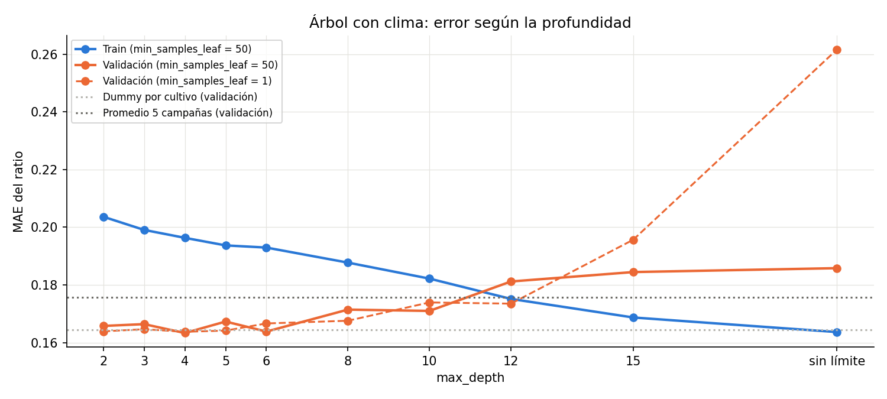
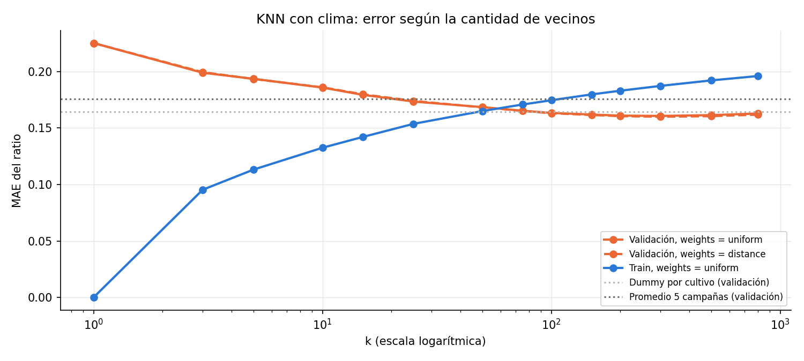
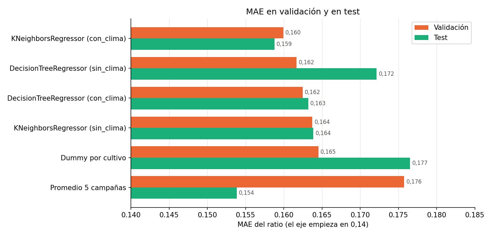
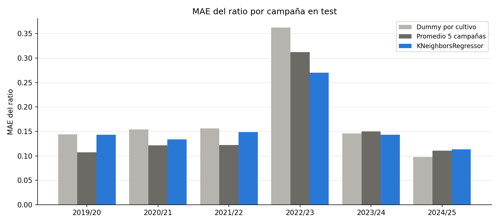
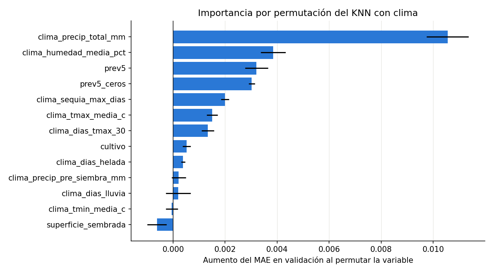
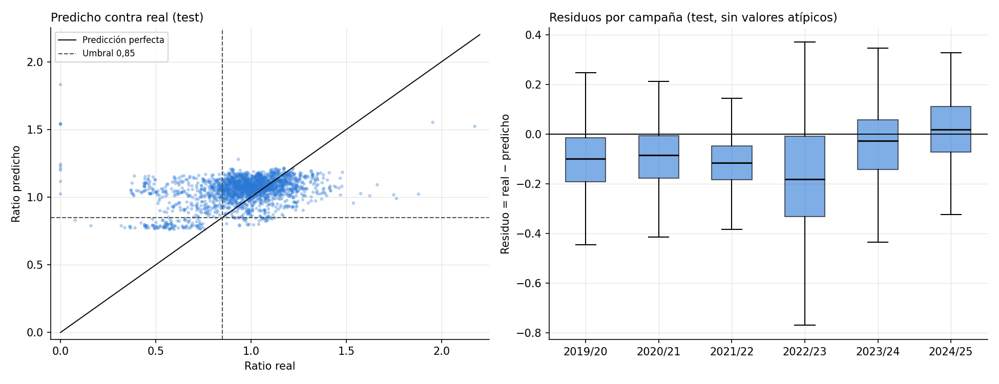

# Entrega 3: regresión

**TP Integrador de Aprendizaje Automático**  
**Proyecto:** rendimiento de cultivos por partido en la Provincia de Buenos Aires  
**Repositorio:** https://github.com/GalvanAlexis/tp-integrador-rendimiento-cultivos

## Datos del trabajo

| Dato | Completar |
|---|---|
| Integrantes | Francisco Calahorra, Federico Valdés, Alexis Galván |
| Curso | Aprendizaje Automático 2026 |
| Fecha de inicio | 13/10/2026 |
| Fecha de entrega | 20/10/2026 |

---

## Resumen ejecutivo

Se compararon los regresores obligatorios (DummyRegressor, DecisionTreeRegressor y KNeighborsRegressor con StandardScaler en un Pipeline), con y sin variables climáticas: **136 configuraciones**, elegidas con validación.

El **regresor seleccionado es KNN con clima, k = 300 y pesos por distancia**. En validación supera a los dos baselines: MAE del ratio 0,160, contra 0,165 del Dummy y 0,176 del promedio de 5 campañas.

En test el resultado es mixto:

- Supera al **Dummy** en todas las métricas.
- **No supera al promedio de 5 campañas en MAE**: 0,159 contra 0,154 en ratio, o 637 contra 626 kg/ha.
- **Sí lo supera** en RMSE en kg/ha (938 contra 981), en R² en kg/ha (0,811 contra 0,793), en la sequía 2022/23 (MAE 0,270 contra 0,313), en soja (0,143 contra 0,162) y en detección de campañas malas (23% contra 0%).

La causa principal es un **sesgo de nivel**: el test (ratio medio 0,96) es más malo que cualquier período de entrenamiento (1,08), y el modelo predice 1,05 en promedio. El modelo ordena bien los casos, pero no conoce el nivel del período nuevo.

El análisis de residuos muestra **regresión hacia la media**: el modelo subestima la magnitud de las campañas muy malas. Por eso, la alerta obtenida desde la regresión detecta solo el 23% de las campañas malas y casi ninguna de las cercanas al umbral. Es el ejemplo concreto de "buen MAE, mala clasificación".

---

## 1. Objetivo y protocolo

**Objetivo de regresión:** `ratio = rendimiento / promedio de las 5 campañas anteriores`. La predicción en kg/ha se obtiene multiplicando el ratio predicho por `prev5`.

**Protocolo** (sin cambios respecto de la Entrega 2):

| Paso | Datos | Uso |
|---|---|---|
| Búsqueda | Train (1981/82 a 2013/14, 11.147 filas) → Validación (2014/15 a 2018/19, 1.828 filas) | Elegir hiperparámetros y modelo |
| Selección | Validación | Menor MAE del ratio |
| Evaluación final | Train + validación → Test (2019/20 a 2024/25, 2.204 filas) | Una sola medición |

Los baselines siguen el mismo esquema. El Dummy recalcula la media del ratio por cultivo con train + validación antes de predecir el test.

**Métrica de selección:** MAE del ratio. Se eligió en la Entrega 2 porque el RMSE es muy sensible a los pocos ratios extremos. También se reportan el RMSE y el R², en ratio y en kg/ha.

## 2. Variables

| Variable | Transformación | Conjunto |
|---|---|---|
| `cultivo` | One-hot | Ambos |
| `superficie_sembrada` | log(1 + x) | Ambos |
| `prev5`, `prev5_ceros` | — | Ambos |
| 9 variables climáticas de la ventana | — | Solo `con_clima` |

En KNN, todas las variables numéricas pasan por `StandardScaler` dentro del Pipeline. El escalador se ajusta solo con los datos de entrenamiento de cada ajuste.

**Variables excluidas:**

- `campania_inicio`: el ratio ya no tiene tendencia, y en test el año queda fuera del rango visto en entrenamiento. Un árbol trataría a todos los años nuevos como el último que vio.
- `municipio_id`: el nivel del partido ya está en `prev5`. Como one-hot, más de 100 columnas distorsionarían las distancias de KNN.
- Objetivo, clases y variables posteriores a la cosecha.

Un test automático verifica que ninguna columna prohibida entre como predictora.

## 3. Búsqueda de hiperparámetros

| Familia | Hiperparámetros | Configuraciones |
|---|---|---:|
| DecisionTreeRegressor | `max_depth` ∈ {2, 3, 4, 5, 6, 8, 10, 12, 15, sin límite} × `min_samples_leaf` ∈ {1, 10, 50, 100} | 40 por conjunto |
| KNeighborsRegressor | k ∈ {1, 3, 5, 10, 15, 25, 50, 75, 100, 150, 200, 300, 500, 800} × `weights` ∈ {uniform, distance} | 28 por conjunto |

Cada configuración se probó con y sin clima: 136 en total. La semilla del árbol es 42.

### 3.1 Profundidad del árbol



El error de train baja siempre al aumentar la profundidad. El de validación baja hasta profundidad 4 (MAE 0,163) y después sube: desde profundidad 8, el árbol memoriza campañas de entrenamiento que no se repiten. Sin límite de profundidad y con hojas de una fila, el MAE de validación llega a 0,264, peor que cualquier baseline. El tamaño mínimo de hoja regulariza: con 50 filas por hoja, los árboles profundos se degradan mucho menos.

### 3.2 Cantidad de vecinos



| k | 1 | 10 | 50 | 100 | 200 | **300** | 500 | 800 |
|---|---:|---:|---:|---:|---:|---:|---:|---:|
| MAE val (distance) | 0,225 | 0,186 | 0,168 | 0,163 | 0,161 | **0,160** | 0,161 | 0,162 |

Con k = 1, el modelo copia al vecino más parecido: MAE de train 0 y de validación 0,225. El error baja hasta k = 300 y vuelve a subir con 500 y 800, cuando el modelo promedia casos demasiado distintos. Que el óptimo sea tan grande indica que la relación entre clima y ratio es ruidosa.

Con pesos por distancia, el MAE de train es casi 0: cada fila de train es su propio vecino a distancia cero. No indica sobreajuste; el desempeño se lee en validación.

### 3.3 Mejor configuración por familia

| Modelo | Variables | Configuración | MAE train | MAE val |
|---|---|---|---:|---:|
| **KNN** | **con clima** | **k = 300, distance** | 0,000 | **0,1599** |
| Árbol | sin clima | depth = 4, leaf = 1 | 0,2015 | 0,1617 |
| Árbol | con clima | depth = 4, leaf = 1 | 0,1937 | 0,1625 |
| KNN | sin clima | k = 800, uniform | 0,2055 | 0,1637 |
| Dummy por cultivo | — | — | — | 0,1645 |
| Promedio 5 campañas | — | — | — | 0,1758 |

Las cuatro configuraciones superan a los dos baselines en validación. El clima mejora a KNN (0,1637 → 0,1599) y empeora levemente al árbol (0,1617 → 0,1625).

### 3.4 Alternativas evaluadas y descartadas

Se evaluaron dos mejoras con motivación previa, **solo con validación**:

1. **Anomalías climáticas.** El ratio es relativo a la historia del partido, pero el clima está en valores absolutos. Cada variable se expresó como diferencia contra la media del mismo partido y cultivo, ajustada solo con datos de entrenamiento.
2. **Ventana de entrenamiento.** El ratio medio baja con el tiempo, de 1,15 en los ochenta a 1,05 en 2015-2019. Se probó entrenar desde 1990 y desde 2000.

| Modelo | Entrena desde | Clima | MAE val |
|---|---:|---|---:|
| **KNN** | **1981** | **absoluto** | **0,1599** |
| KNN | 1990 | absoluto | 0,1601 |
| KNN | 1981 | anomalías | 0,1623 |
| Árbol | 1981 | absoluto | 0,1625 |
| Árbol | 1990 | anomalías | 0,1628 |
| KNN | 2000 | absoluto | 0,1637 |

Ninguna alternativa supera a la configuración original. Se descartan.

**Transparencia:** los resultados de test de la primera versión se vieron antes de evaluar estas alternativas. Por eso la decisión se tomó exclusivamente con validación, y no se cambió el modelo por lo observado en test.

## 4. Tabla comparativa

Modelos reentrenados con train + validación y evaluados en test.

| Modelo | MAE val | MAE test | RMSE test | R² test | MAE kg/ha | RMSE kg/ha | R² kg/ha |
|---|---:|---:|---:|---:|---:|---:|---:|
| Dummy por cultivo | 0,1645 | 0,1765 | 0,2441 | −0,307 | 756 | 1.174 | 0,704 |
| Promedio 5 campañas | 0,1758 | **0,1538** | **0,2172** | **−0,035** | **626** | 981 | 0,793 |
| **KNN con clima (seleccionado)** | **0,1599** | 0,1588 | 0,2233 | −0,094 | 637 | **938** | **0,811** |
| Árbol sin clima | 0,1617 | 0,1722 | 0,2606 | −0,490 | 713 | 1.123 | 0,729 |
| Árbol con clima | 0,1625 | 0,1632 | 0,2462 | −0,331 | 658 | 955 | 0,804 |
| KNN sin clima | 0,1637 | 0,1639 | 0,2325 | −0,186 | 675 | 1.059 | 0,759 |

Las columnas sin unidad están en ratio.



**Lectura:**

- El orden entre modelos cambia de validación a test. El promedio de 5 campañas pasa de ser el peor en validación al mejor en MAE de test.
- El KNN con clima mejora al pasar a test (0,1599 → 0,1588); el árbol con clima queda casi igual (0,1625 → 0,1632). El árbol sin clima y el Dummy son los que más empeoran (+0,011 y +0,012).
- El KNN tiene el menor RMSE y el mayor R² en kg/ha: comete menos errores grandes en kg/ha, pero un poco más de errores chicos.
- El **R² del ratio es negativo** en test para todos los modelos. El R² compara contra la media del test (0,96), que ningún modelo conocía. No significa que el modelo no aprenda nada: refleja el cambio de nivel entre períodos.

## 5. Errores por campaña y por cultivo

### 5.1 Por campaña

| Campaña | Ratio real | Ratio predicho (KNN) | MAE Dummy | MAE Promedio 5 | MAE KNN |
|---|---:|---:|---:|---:|---:|
| 2019/20 | 0,958 | 1,061 | 0,144 | **0,107** | 0,143 |
| 2020/21 | 0,965 | 1,055 | 0,154 | **0,121** | 0,134 |
| 2021/22 | 0,954 | 1,081 | 0,156 | **0,122** | 0,149 |
| **2022/23** | **0,773** | **0,950** | 0,363 | 0,313 | **0,270** |
| 2023/24 | 1,043 | 1,096 | 0,146 | 0,150 | **0,143** |
| 2024/25 | 1,066 | 1,046 | **0,098** | 0,110 | 0,114 |



- En la sequía **2022/23**, el KNN es el mejor modelo y el único que baja su predicción. Esto confirma la hipótesis de la Entrega 2: el clima permite anticipar parte de esa campaña.
- Entre **2019/20 y 2021/22**, el ratio real rondó 0,96 y el KNN predijo alrededor de 1,06. Arrastra el nivel de entrenamiento y pierde contra el promedio de 5 campañas, que predice 1.
- En **2023/24 y 2024/25**, años buenos, los modelos quedan parejos.

### 5.2 Sesgo de nivel

| Indicador | Valor |
|---|---:|
| Ratio medio predicho en test | 1,048 |
| Ratio medio real en test | 0,960 |
| Sesgo | +0,088 |
| Correlación de Spearman entre predicción y valor real | 0,31 |
| MAE si se quitara el sesgo (solo diagnóstico) | 0,143 |

Sin el sesgo, el KNN tendría un MAE de 0,143, mejor que el 0,154 del promedio de 5 campañas. Es solo un diagnóstico: el sesgo se calcula con el test, y no se conoce al predecir.

Muestra que el modelo **ordena** bien los casos y que el problema principal está en el **nivel**. El ratio medio bajó de 1,08 en train a 0,96 en test, por la desaceleración tecnológica y por varios años secos. La validación (2014-2018, ratio medio 1,07) no podía anticiparlo.

### 5.3 Por cultivo

| Cultivo | MAE Dummy | MAE Promedio 5 | MAE KNN | R² ratio KNN |
|---|---:|---:|---:|---:|
| Soja total | 0,181 | 0,162 | **0,143** | **+0,288** |
| Maíz | 0,196 | **0,153** | **0,153** | −0,171 |
| Girasol | 0,123 | **0,112** | 0,128 | −0,236 |
| Trigo total | 0,194 | **0,179** | 0,205 | −0,360 |

El clima explica bien la soja y algo del maíz, pero no el trigo ni el girasol. Coincide con las correlaciones calculadas en la Entrega 2. Para los cultivos de invierno harían falta otras variables, como heladas tardías en floración o excesos de agua.

## 6. Importancia de las variables

Importancia por permutación sobre validación, con el KNN ajustado en train.



| Variable | Aumento del MAE al permutar |
|---|---:|
| `clima_precip_total_mm` | 0,0106 |
| `clima_humedad_media_pct` | 0,0038 |
| `prev5` | 0,0032 |
| `prev5_ceros` | 0,0030 |
| `clima_sequia_max_dias` | 0,0020 |
| `superficie_sembrada` | −0,0006 |

La **precipitación de la ventana** es la variable más importante, casi tres veces más que la segunda. La señal climática útil es hídrica. `prev5_ceros`, agregada en la Entrega 2, aporta tanto como `prev5`.

La superficie sembrada tiene importancia negativa: en KNN agrega ruido a las distancias. Conviene evaluar con validación un modelo sin ella.

## 7. Residuos



| Ratio real | Filas | Ratio real medio | Ratio predicho medio |
|---|---:|---:|---:|
| ≤ 0,60 | 163 | 0,466 | 0,960 |
| 0,60 a 0,75 | 138 | 0,682 | 0,955 |
| 0,75 a 0,85 | 170 | 0,807 | 1,027 |
| 0,85 a 0,95 | 451 | 0,904 | 1,055 |
| 0,95 a 1,05 | 556 | 1,000 | 1,058 |
| 1,05 a 1,20 | 531 | 1,113 | 1,075 |
| > 1,20 | 195 | 1,299 | 1,086 |

La nube de predicciones es mucho más horizontal que la diagonal. Es **regresión hacia la media**: el desvío estándar de la predicción es 0,10 y el del valor real, 0,21. Con k = 300 vecinos, el modelo promedia muchos casos y suaviza los extremos. Las campañas con ratio real menor a 0,6 se predicen en 0,96 en promedio.

Por campaña, los residuos de 2019/20 a 2021/22 están corridos por debajo de 0 (sesgo de nivel), y 2022/23 tiene la dispersión más grande.

## 8. Errores importantes

Se ordenan por el error en **toneladas del partido**: error en kg/ha × superficie sembrada.

| Cultivo | Campaña | Partido | Real kg/ha | Predicho kg/ha | Error (t) |
|---|---|---|---:|---:|---:|
| Maíz | 2022/23 | Carlos Casares | 650 | 7.029 | −251.973 |
| Maíz | 2021/22 | Tres Arroyos | 4.000 | 6.492 | −230.575 |
| Maíz | 2021/22 | Necochea | 3.500 | 7.154 | −222.169 |
| Maíz | 2023/24 | Coronel Dorrego | 2.500 | 4.888 | −218.291 |
| Soja | 2022/23 | 9 de Julio | 1.370 | 2.468 | −188.933 |
| Trigo | 2022/23 | General Villegas | 2.000 | 3.644 | −187.399 |
| Maíz | 2021/22 | General Villegas | 7.750 | 9.291 | −183.378 |
| Trigo | 2022/23 | Tres Arroyos | 2.433 | 4.425 | −182.350 |
| Maíz | 2024/25 | Trenque Lauquen | 8.300 | 6.985 | +177.956 |
| Maíz | 2022/23 | 9 de Julio | 4.000 | 6.925 | −175.511 |

- **Nueve de los diez errores más grandes son sobreestimaciones en campañas malas**, en partidos grandes del oeste y del sur. Para el usuario, es el error más costoso: se esperaba una campaña normal, no se tomó cobertura y la cosecha cayó.
- **Pérdidas totales.** Los 10 casos con rendimiento 0 en test son de maíz, en partidos donde el cultivo es marginal (Tordillo, Dolores, Bahía Blanca, General Lavalle). El modelo predice ratios normales o altos: con varios ceros previos, `prev5` es bajo y el modelo espera un rebote. Con estas variables no se pueden anticipar.

## 9. Casos cercanos al umbral

Alerta obtenida desde la regresión: `ratio predicho < 0,85`.

| Ratio real | Filas | Clase real | MAE ratio | Mal clasificados |
|---|---:|---|---:|---:|
| < 0,75 | 301 | Mala | 0,393 | 65% |
| 0,75 a 0,85 | 170 | Mala | 0,220 | **98%** |
| 0,85 a 0,95 | 451 | No mala | 0,156 | 1% |
| ≥ 0,95 | 1.282 | No mala | 0,097 | 2% |

- Las campañas malas **cercanas al umbral** quedan casi todas mal clasificadas. Un error de 0,22 en ratio alcanza para dejarlas del lado "no mala".
- De las campañas **muy malas**, el modelo detecta alrededor de un tercio.
- En las campañas normales casi no hay falsas alarmas.

En total, la regresión emite 139 alertas, de las cuales 107 son correctas, sobre 470 campañas malas reales: **recall de 23% y precisión de 77%**. Los baselines no emiten ninguna alerta. El clasificador directo de la Clase 4 tiene que mejorar este recall.

## 10. Regresor seleccionado

| Campo | Valor |
|---|---|
| Modelo | `KNeighborsRegressor(n_neighbors=300, weights="distance")` |
| Preprocesamiento | One-hot de `cultivo`; log(1 + x) y escalado de `superficie_sembrada`; escalado del resto |
| Variables | `cultivo`, `superficie_sembrada`, `prev5`, `prev5_ceros` y 9 variables climáticas |
| Entrenado con | Train + validación (1981/82 a 2018/19) |
| Archivo | `modelos/regresor.joblib`, un Pipeline completo |
| Metadata | `modelos/regresor_metadata.json`, con variables, hiperparámetros, métricas y versiones |

**Por qué este modelo:** tiene el menor MAE de validación, que es el criterio fijado antes de mirar el test. En test supera al Dummy en todas las métricas. Contra el promedio de 5 campañas pierde en MAE, pero lo supera en RMSE y R² en kg/ha, en la sequía 2022/23, en soja y en detección de campañas malas.

Ejemplo, Chascomús 2022/23:

| Cultivo | Real kg/ha | Predicho kg/ha | Ratio real | Ratio predicho | Alerta por regresión |
|---|---:|---:|---:|---:|---|
| Maíz | 5.506 | 6.160 | 0,70 | 0,79 | Sí |
| Soja | 1.424 | 2.325 | 0,49 | 0,79 | Sí |
| Girasol | 2.200 | 2.223 | 0,94 | 0,95 | No |
| Trigo | 2.191 | 4.333 | 0,54 | 1,06 | No (falso negativo) |

## 11. Preguntas del informe

**¿El modelo de regresión supera al baseline?** Supera al Dummy en validación y en test. Contra el promedio de 5 campañas, el baseline más exigente, gana en validación y pierde en el MAE de test por 0,005 en ratio, o 11 kg/ha. Gana en RMSE y R² en kg/ha.

**¿Qué significa el MAE?** Un MAE de 0,159 en ratio equivale a 637 kg/ha. En promedio, la predicción se aleja del rendimiento real alrededor de un 16% del promedio histórico del partido. En maíz, el cultivo de mayor rendimiento, el error medio ronda los 1.000 kg/ha.

**¿Es posible obtener un buen MAE y una mala clasificación?** Sí. Los baselines de la Entrega 2 lo mostraron con recall 0. Este modelo lo muestra de nuevo: con un MAE competitivo, la alerta por regresión detecta el 23% de las campañas malas y casi ninguna de las cercanas al umbral, por la regresión hacia la media.

**¿Qué sucede con los casos cercanos al umbral?** El 98% de las campañas con ratio real entre 0,75 y 0,85 quedan mal clasificadas.

## 12. Limitaciones

- **Cambio de nivel entre períodos.** Si el contexto productivo cambia, el modelo arrastra el nivel de entrenamiento. Es la principal fuente de error en test.
- **Trigo y girasol.** El modelo no supera al promedio de 5 campañas en estos cultivos. No conviene usarlo para ellos sin nuevas variables.
- **Extremos.** El modelo subestima la magnitud de las campañas muy malas y no anticipa las pérdidas totales.
- **Clima de reanálisis.** NASA POWER suaviza extremos locales, y el centroide del partido no representa todo su territorio.
- **Fechas de corte únicas** para toda la provincia, como se discutió en la Entrega 2.

## 13. Próximos pasos (Clase 4)

1. Entrenar los clasificadores obligatorios y comparar el clasificador directo con la alerta por regresión.
2. Evaluar con validación, sin usar el test, un modelo por cultivo, la exclusión de la superficie sembrada y alguna forma de recalibrar el nivel.
3. Definir el esquema de costos de falsos positivos y falsos negativos.

## 14. Reproducibilidad

```bash
python -m src.regresion
python -m nbconvert --to notebook --execute --inplace notebooks/03_regresion.ipynb
```

`src.regresion` corre la búsqueda, la evaluación final, guarda las tablas en `datos/procesado/regresion_*.csv` y el regresor en `modelos/`. El notebook ejecuta el mismo protocolo y genera las figuras. La semilla es 42. Las versiones están en `modelos/regresor_metadata.json`.

| Archivo | Contenido |
|---|---|
| `datos/procesado/regresion_busqueda_validacion.csv` | Las 136 configuraciones con MAE de train y validación |
| `datos/procesado/regresion_comparacion.csv` | Tabla comparativa de validación y test |
| `datos/procesado/regresion_por_cultivo_test.csv` | Métricas por cultivo |
| `datos/procesado/regresion_por_campania_test.csv` | Métricas por campaña |
| `datos/procesado/regresion_predicciones_test.csv` | Predicciones y residuos del regresor seleccionado |
| `modelos/regresor.joblib` | Pipeline entrenado |
| `notebooks/03_regresion.ipynb` | Notebook ejecutado |
