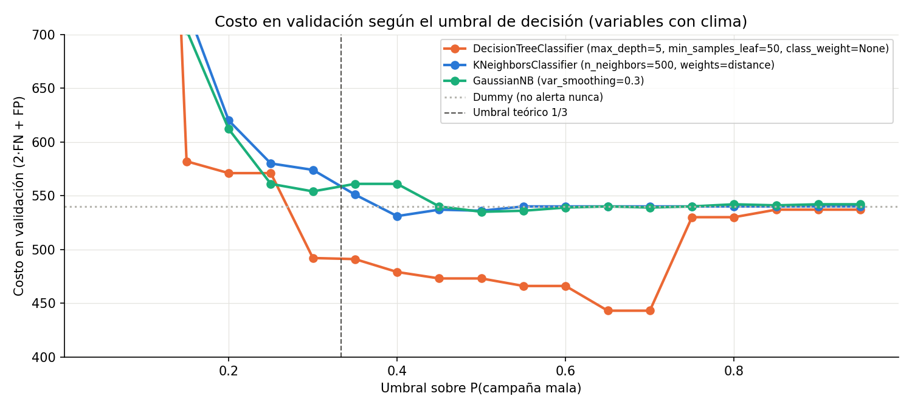
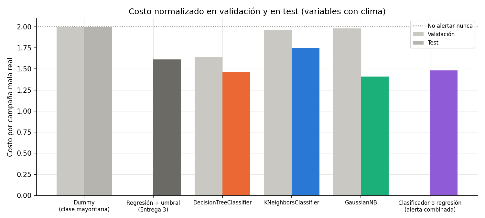
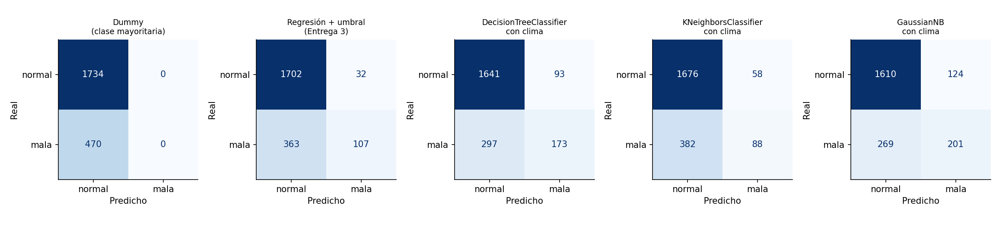
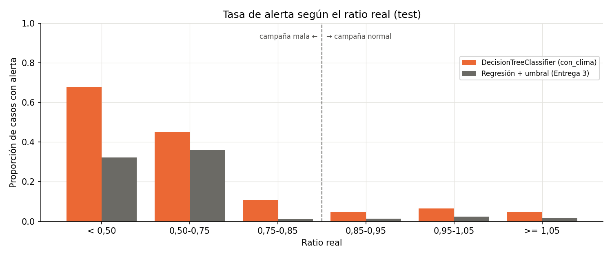
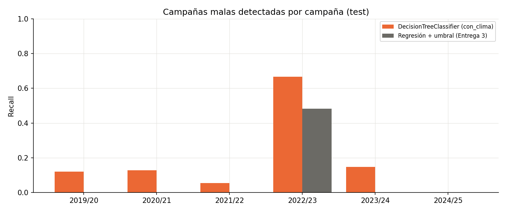

# Rendimiento de cultivos por partido: ¿se viene una campaña mala?

**Informe final — TP Integrador de Aprendizaje Automático**

| Dato | Completar |
|---|---|
| Integrantes | Francisco Calahorra, Federico Valdés, Alexis Galván |
| Curso | Aprendizaje Automático 2026 |
| Fecha de inicio | 13/10/2026 |
| Fecha de entrega final | 28/10/2026 |
| Repositorio | https://github.com/GalvanAlexis/tp-integrador-rendimiento-cultivos |
| Aplicación publicada | https://tp-integrador-rendimiento-cultivos.vercel.app |

---

## Resumen ejecutivo

El trabajo predice el rendimiento de cuatro cultivos en los partidos de la Provincia de Buenos Aires antes de la cosecha y anticipa si la campaña va a ser mala. La unidad de análisis es **partido × cultivo × campaña** y la variable de modelado es el **ratio**: el rendimiento de la campaña dividido por el promedio de las cinco campañas anteriores del mismo partido y cultivo. Una campaña es mala cuando ese ratio queda por debajo de **0,85**.

Se usaron 15.179 filas (1981/82 a 2024/25) del catálogo de Estimaciones Agrícolas de la Provincia de Buenos Aires, combinadas con nueve variables climáticas de NASA POWER para la ventana de cada cultivo. El split es temporal: train hasta 2013/14, validación de 2014/15 a 2018/19 y test de 2019/20 a 2024/25. El test nunca se usó para elegir modelos ni hiperparámetros.

| Tarea | Modelo seleccionado | Resultado en test |
|---|---|---|
| Regresión | KNN con clima, k = 300, pesos por distancia | MAE del ratio 0,159; 637 kg/ha |
| Clasificación | Árbol con clima, profundidad 5, hojas de 50 filas, umbral 0,65 | Recall 0,37; 173 de 470 campañas malas detectadas |
| Alerta por regresión + umbral | KNN y corte en ratio 0,85 | Recall 0,23; 107 de 470 |

Los tres hallazgos que ordenan el informe:

1. **El clima es la señal.** Sin variables climáticas, ningún clasificador supera al Dummy y el árbol de regresión pierde contra el promedio de cinco campañas. Con clima, los dos modelos se separan del piso.
2. **La regresión predice bien la magnitud pero mal la alerta.** Su MAE es competitivo, pero comprime las predicciones hacia la media y solo detecta el 23 % de las campañas malas. Es el ejemplo más claro de la consigna: se puede tener un buen MAE y una mala clasificación.
3. **El clasificador directo es la mejor alerta.** Con el esquema de costos del proyecto (un falso negativo cuesta el doble que un falso positivo), baja el costo de 940 a 687, un 27 % menos que no alertar nunca. Cuando los dos sistemas coinciden, el 89,5 % de las alertas son campañas malas reales.

La aplicación Flask está publicada en Vercel y usa exactamente los dos pipelines guardados que se evalúan en este informe.

---

## 1. Problema, usuario y decisión

### 1.1 Problema

El rendimiento de un cultivo en un partido depende del clima de la campaña, pero también de la tecnología disponible, del suelo, de la superficie sembrada y de eventos puntuales. Un productor tiene que decidir insumos, cobertura de seguro, financiamiento y venta anticipada **antes** de conocer el resultado de la cosecha. La pregunta que ordena el proyecto es:

> Con la información disponible al final del período crítico del cultivo, ¿qué rendimiento se espera y hay que prepararse para una campaña mala?

### 1.2 Usuario y decisión

- **Usuario:** productores, asesores agronómicos, cooperativas, aseguradoras y áreas municipales de producción.
- **Decisión:** contratar o reforzar cobertura, vender una parte de la cosecha a futuro, gestionar financiamiento o priorizar asistencia técnica en los partidos con alerta.
- **Costo del error:** una campaña mala sin alerta deja al productor sin cobertura y sin margen. Una falsa alarma cuesta una prima o una consulta que no hacían falta. Los dos errores no pesan lo mismo, y eso se refleja en el umbral de decisión.

### 1.3 Momento de la predicción

La predicción se hace en una **fecha de corte fija por cultivo**, al final del período crítico y antes de la cosecha. Todas las variables usadas están disponibles en ese momento.

| Cultivo | Fecha de corte |
|---|---|
| Trigo | 15/11 |
| Maíz | 31/01 |
| Girasol | 31/01 |
| Soja | 28/02 |

### 1.4 Las dos tareas

La consigna pide resolver dos tareas sobre los mismos datos y comparar dos formas de generar la alerta.

| Tarea | Pregunta | Salida |
|---|---|---|
| Regresión | ¿Qué rendimiento se espera? | kg/ha |
| Clasificación | ¿La campaña será mala? | Alerta sí/no |

| Sistema de alerta | Procedimiento |
|---|---|
| Clasificador directo | Predice la clase a partir de las variables |
| Regresión más umbral | Predice el ratio y aplica el corte en 0,85 |

---

## 2. Datos

### 2.1 Fuente

**Estimaciones Agrícolas**, Datos Abiertos de la Provincia de Buenos Aires.

- Organismo: Ministerio de Economía. Secretaría de Agricultura, Ganadería y Pesca. Dirección de Estimaciones Agrícolas.
- Licencia: CC BY 4.0.
- Catálogo: https://catalogo.datos.gba.gob.ar/dataset/estimaciones-agro
- Archivo: `datos/raw/estimaciones-agricolas-1969_2026.csv`, 2,82 MB, 53.905 filas.
- SHA-256: `a3b8e1295978343847324b2c3dff4d41b985f093372b34b1290cbc7ad75934e0`
- Clima: **NASA POWER**, datos diarios desde 1981, grilla de aproximadamente 0,5°.

El archivo se descarga una vez y queda en caché; el notebook verifica el hash antes de usarlo. Los datos no contienen información personal.

### 2.2 Alcance

Se conservaron cuatro cultivos y el período 1981/82 a 2024/25.

| Criterio | Decisión | Motivo |
|---|---|---|
| Cultivos | Maíz, trigo total, girasol y soja total | Cubren el grueso de la superficie y tienen serie larga |
| Excluidos | Sorgo y cebada cervecera | Sorgo tiene 14,5 % de rendimientos en cero; cebada termina en 2015/16 |
| Campañas | 1981/82 a 2024/25 | NASA POWER empieza en 1981; 2025/26 está incompleta |
| Unidad | partido × cultivo × campaña | Es el nivel en que se publican los datos y en que decide el usuario |

### 2.3 Calidad y limpieza

| Control | Resultado |
|---|---|
| Filas totales | 53.905 |
| Duplicados por cultivo, campaña y municipio | 0 |
| Superficie cosechada mayor que sembrada | 0 casos |
| Consistencia rendimiento vs producción / cosechada | Diferencia menor al 1 % |
| Rendimiento negativo o superficie no positiva | 3 filas, eliminadas |
| Ratio mayor a 3 | 12 filas, conservadas y documentadas |
| Faltantes en el dataset de modelado | 0 |

| Paso | Filas antes | Filas después | Removidas |
|---|---:|---:|---:|
| Lectura del CSV | 53.905 | 53.905 | 0 |
| Filtrar cultivos | 53.905 | 20.495 | 33.410 |
| Filtrar campañas | 20.495 | 20.393 | 102 |
| Quitar valores inválidos | 20.393 | 20.390 | 3 |
| Dataset de modelado | 20.390 | 15.179 | 5.211 |

Las 5.211 filas que se pierden son campañas anteriores a 1981 o filas sin las cinco campañas calendario previas. El promedio se calcula sobre una **grilla de calendario**: si falta un año, el promedio queda nulo y la fila no entra. Así se respeta el momento de la decisión y no se saltean huecos.

**Rendimientos en cero.** Hay 188 filas con rendimiento 0 y superficie cosechada 0 en los cuatro cultivos: 109 de maíz, 58 de soja, 18 de trigo y 3 de girasol. Se interpretan como **campaña sin cosecha**, no como un rendimiento medido, y se conservan porque son el caso más costoso para el usuario. En el dataset de modelado quedan 27 en train, 9 en validación y 10 en test.

**Ratios extremos.** 12 filas tienen un ratio mayor a 3: la cosecha triplicó el promedio de las cinco campañas previas. No son errores de carga: son partidos donde el cultivo era marginal y hubo campañas sin cosecha entre las cinco anteriores, lo que hunde el promedio. Por eso el modelo recibe `prev5_ceros` como variable.

### 2.4 Variables

| Variable | Rol | Transformación |
|---|---|---|
| `cultivo` | Predictora | One-hot |
| `superficie_sembrada` | Predictora | log(1 + x) |
| `prev5` | Predictora | Promedio de las 5 campañas anteriores |
| `prev5_ceros` | Predictora | Cantidad de ceros en esas 5 campañas |
| 9 variables climáticas | Predictoras | Precipitación total, días > 30 °C, temperaturas medias, humedad, racha seca, lluvia previa a la siembra, heladas y días de lluvia |
| `ratio` | Objetivo de regresión | rendimiento / `prev5` |
| `mala85` | Objetivo de clasificación | 1 si el ratio real < 0,85 |

El diccionario completo está en `datos/diccionario_variables.md`.

**Por qué se modela el ratio y no los kilos.** El rendimiento mediano se duplicó entre 1981 y 2024 por la mejora tecnológica. Un modelo entrenado hasta 2013 que prediga kilos arrastra ese nivel y no puede extrapolar. El ratio descuenta la tendencia y las diferencias de suelo entre partidos, y es comparable entre cultivos.

### 2.5 Controles de fuga de información

- **Variables excluidas:** `campania_inicio` (el año de test queda fuera del rango visto en entrenamiento), `municipio_id` (el nivel del partido ya está en `prev5`), `rendimiento`, `ratio`, `mala80`, `mala85`, `mala90`, `perdida_total` y todo lo posterior a la cosecha.
- **Split antes de mirar nada:** el split se fija en la preparación y no se toca. Un test automático verifica que la función de búsqueda solo recibe train y validación.
- **Transformaciones ajustadas solo con train:** el `StandardScaler` y el one-hot viven dentro del Pipeline, así que en cada ajuste se calculan con los datos de entrenamiento de ese ajuste.
- **Mismos casos para las dos tareas:** regresión y clasificación se evalúan sobre exactamente las mismas 2.204 filas de test.

---

## 3. Protocolo de evaluación

### 3.1 Split temporal

| Conjunto | Campañas | Filas | Uso |
|---|---|---|---|
| Train | 1981/82 a 2013/14 | 11.147 | Ajustar modelos y buscar hiperparámetros |
| Validación | 2014/15 a 2018/19 | 1.828 | Elegir modelo, hiperparámetros y umbral |
| Test | 2019/20 a 2024/25 | 2.204 | Una sola medición final |

El split es temporal y no aleatorio porque todos los partidos de una campaña comparten el mismo clima: un split aleatorio filtraría información del futuro al pasado.

La prevalencia de la clase mala cambia entre períodos: 18,0 % en train, 14,8 % en validación y 21,3 % en test. La sequía 2022/23 cae entera en test y explica buena parte de esa diferencia. Es la razón por la que las métricas de validación y de test no son intercambiables.

### 3.2 Métricas

| Tarea | Métricas | Criterio de selección |
|---|---|---|
| Regresión | MAE, RMSE y R², en ratio y en kg/ha | MAE del ratio en validación |
| Clasificación | Accuracy, precisión, recall, F1, matriz de confusión y costo total | Costo total en validación |

Se eligió el MAE del ratio y no el RMSE porque el RMSE es muy sensible a los pocos ratios extremos. El R² se informa, pero se lee con cuidado: compara contra la media del test, un nivel que ningún modelo conocía.

### 3.3 Baselines

| Baseline | Definición |
|---|---|
| DummyRegressor / DummyClassifier | Media del ratio por cultivo (regresión) y clase mayoritaria (clasificación) |
| Promedio de 5 campañas | Usa el `prev5` que ya está en los datos, sin modelo |

Los dos baselines se recalcularon con train + validación antes de predecir el test, igual que los modelos finales. El promedio de cinco campañas es un baseline exigente: es, en la práctica, lo que hace un productor sin modelo.

### 3.4 Esquema de costos

| Error | Descripción | Costo relativo |
|---|---|---|
| Falso negativo | Campaña mala sin alerta | 2 |
| Falso positivo | Alerta en una campaña normal | 1 |

**Costo total = 2 × FN + FP.** El criterio es que no anticipar una campaña mala deja al productor sin cobertura y sin margen, mientras que una falsa alarma cuesta una prima o una consulta. Con este esquema, una alerta conviene cuando la probabilidad de campaña mala supera 1/3, así que el umbral de probabilidad se trata como un hiperparámetro y no se fija en 0,5.

El Dummy nunca alerta, así que su costo es 2 × la cantidad de campañas malas: 540 en validación y 940 en test. Es el piso que cualquier modelo útil tiene que superar.

### 3.5 Reproducibilidad

- Semilla: 42 en todos los modelos con componente aleatorio.
- Versiones registradas en `modelos/regresor_metadata.json` y `modelos/clasificador_metadata.json`: Python 3.14.2, pandas 3.0.2, numpy 2.4.2, scikit-learn 1.9.0, joblib 1.5.3.
- `requirements.txt` fija las versiones de producción; `requirements-dev.txt` agrega matplotlib, requests, pytest y Jupyter.
- `notebooks/entrenamiento.ipynb` recorre las cinco etapas y controla los conteos contra `datos/procesado/metadata_preparacion.json`.

---

## 4. Regresión

### 4.1 Búsqueda

Se probaron dos familias obligatorias, con y sin clima: **136 configuraciones**.

| Familia | Hiperparámetros | Configuraciones por conjunto |
|---|---|---:|
| DecisionTreeRegressor | `max_depth` ∈ {2, 3, 4, 5, 6, 8, 10, 12, 15, sin límite} × `min_samples_leaf` ∈ {1, 10, 50, 100} | 40 |
| KNeighborsRegressor (StandardScaler en el Pipeline) | k ∈ {1, 3, 5, 10, 15, 25, 50, 75, 100, 150, 200, 300, 500, 800} × pesos ∈ {uniform, distance} | 28 |

Mejor configuración por familia, medida en validación:

| Modelo | Variables | Configuración | MAE train | MAE val |
|---|---|---|---:|---:|
| **KNN** | **con clima** | **k = 300, distance** | 0,000 | **0,1599** |
| Árbol | sin clima | depth = 4, leaf = 1 | 0,2015 | 0,1617 |
| Árbol | con clima | depth = 4, leaf = 1 | 0,1937 | 0,1625 |
| KNN | sin clima | k = 800, uniform | 0,2055 | 0,1637 |
| Dummy por cultivo | — | — | — | 0,1645 |
| Promedio 5 campañas | — | — | — | 0,1758 |


- El error de train baja siempre al aumentar la profundidad. El de validación baja hasta profundidad 4 y después sube: desde profundidad 8 el árbol memoriza campañas que no se repiten. Sin límite de profundidad y con hojas de una fila, el MAE de validación llega a 0,264, peor que cualquier baseline.
- En KNN, el error baja hasta k = 300 y vuelve a subir con 500 y 800, cuando el modelo promedia casos demasiado distintos. Que el óptimo sea tan grande indica que la relación entre clima y ratio es ruidosa.
- Con pesos por distancia, el MAE de train de KNN es casi 0: cada fila es su propio vecino. No indica sobreajuste; el desempeño se lee en validación.


Se evaluaron además dos alternativas, solo con validación: anomalías climáticas (cada variable como diferencia contra la media del partido y cultivo) y ventanas de entrenamiento más cortas. Ninguna supera a la configuración original: el KNN con clima absoluto queda en 0,1599, las anomalías en 0,1623 y entrenar desde 2000 en 0,1637. Se descartaron.

### 4.2 Comparación en test

Modelos reentrenados con train + validación y medidos una sola vez en test.

| Modelo | MAE val | MAE test | RMSE test | R² test | MAE kg/ha | RMSE kg/ha | R² kg/ha |
|---|---:|---:|---:|---:|---:|---:|---:|
| Dummy por cultivo | 0,1645 | 0,1765 | 0,2441 | −0,307 | 756 | 1.174 | 0,704 |
| Promedio 5 campañas | 0,1758 | **0,1538** | **0,2172** | **−0,035** | **626** | 981 | 0,793 |
| **KNN con clima (seleccionado)** | **0,1599** | 0,1588 | 0,2233 | −0,094 | 637 | **938** | **0,811** |
| Árbol sin clima | 0,1617 | 0,1722 | 0,2606 | −0,490 | 713 | 1.123 | 0,729 |
| Árbol con clima | 0,1625 | 0,1632 | 0,2462 | −0,331 | 658 | 955 | 0,804 |
| KNN sin clima | 0,1637 | 0,1639 | 0,2325 | −0,186 | 675 | 1.059 | 0,759 |

Las columnas sin unidad están en ratio.


**Lectura:**

- El KNN supera al Dummy en todas las métricas y a las otras dos familias en MAE y en R² en kg/ha.
- Contra el **promedio de 5 campañas**, el baseline exigente, pierde en MAE por 0,005 en ratio, o 11 kg/ha. Lo supera en RMSE (938 contra 981 kg/ha), en R² en kg/ha (0,811 contra 0,793), en la sequía 2022/23, en soja y en detección de campañas malas.
- El orden cambia de validación a test: el promedio de 5 campañas pasa de ser el peor al mejor en MAE. Es el efecto del cambio de nivel, que se analiza abajo.
- El **R² del ratio es negativo** para todos los modelos. Compara contra la media del test (0,96), que ningún modelo conocía. No significa que no aprendan: significa que el nivel del período nuevo está fuera del rango de entrenamiento.
- **Sin clima, los modelos no sirven.** El KNN sin clima queda en 0,1639 y el árbol sin clima en 0,1722, cerca del Dummy.

### 4.3 Sesgo de nivel y residuos

| Indicador | Valor |
|---|---:|
| Ratio medio predicho en test | 1,048 |
| Ratio medio real en test | 0,960 |
| Sesgo | +0,088 |
| Correlación de Spearman entre predicción y valor real | 0,31 |
| Desvío estándar de la predicción | 0,100 |
| Desvío estándar del valor real | 0,214 |
| MAE si se quitara el sesgo (solo diagnóstico) | 0,143 |


| Ratio real | Filas | Ratio real medio | Ratio predicho medio |
|---|---:|---:|---:|
| ≤ 0,60 | 163 | 0,466 | 0,960 |
| 0,60 a 0,75 | 138 | 0,682 | 0,955 |
| 0,75 a 0,85 | 170 | 0,807 | 1,027 |
| 0,85 a 0,95 | 451 | 0,904 | 1,055 |
| 0,95 a 1,05 | 556 | 1,000 | 1,058 |
| 1,05 a 1,20 | 531 | 1,113 | 1,075 |
| > 1,20 | 195 | 1,299 | 1,086 |

La nube de predicciones es mucho más horizontal que la diagonal: es **regresión hacia la media**. Con k = 300 vecinos el modelo promedia muchos casos y suaviza los extremos. Las campañas con ratio real menor a 0,60 se predicen en 0,96 en promedio.

Sin el sesgo, el KNN tendría un MAE de 0,143, mejor que el 0,154 del promedio de 5 campañas. Es solo un diagnóstico: el sesgo se calcula con el test y no se conoce al predecir. Lo que muestra es que el modelo **ordena** bien los casos y que el problema principal está en el **nivel**.

### 4.4 Errores por campaña y por cultivo

| Campaña | Ratio real | Ratio predicho (KNN) | MAE Dummy | MAE Promedio 5 | MAE KNN |
|---|---:|---:|---:|---:|---:|
| 2019/20 | 0,958 | 1,061 | 0,144 | **0,107** | 0,143 |
| 2020/21 | 0,965 | 1,055 | 0,154 | **0,121** | 0,134 |
| 2021/22 | 0,954 | 1,081 | 0,156 | **0,122** | 0,149 |
| **2022/23** | **0,773** | **0,950** | 0,363 | 0,313 | **0,270** |
| 2023/24 | 1,043 | 1,096 | 0,146 | 0,150 | **0,143** |
| 2024/25 | 1,066 | 1,046 | **0,098** | 0,110 | 0,114 |


- En la sequía **2022/23** el KNN es el mejor modelo y el único que baja su predicción: el clima permite anticipar parte de esa campaña.
- Entre **2019/20 y 2021/22** el ratio real rondó 0,96 y el KNN predijo alrededor de 1,06. Arrastra el nivel de entrenamiento y pierde contra el promedio de 5 campañas, que predice 1.

| Cultivo | MAE Dummy | MAE Promedio 5 | MAE KNN | R² ratio KNN |
|---|---:|---:|---:|---:|
| Soja total | 0,181 | 0,162 | **0,143** | **+0,288** |
| Maíz | 0,196 | **0,153** | **0,153** | −0,171 |
| Girasol | 0,123 | **0,112** | 0,128 | −0,236 |
| Trigo total | 0,194 | **0,179** | 0,205 | −0,360 |

El clima explica bien la soja y algo del maíz, pero no el trigo ni el girasol. Para los cultivos de invierno harían falta otras variables, como heladas tardías en floración o excesos de agua.

**Importancia de las variables** (permutación sobre validación, KNN ajustado en train):


| Variable | Aumento del MAE al permutar |
|---|---:|
| `clima_precip_total_mm` | 0,0106 |
| `clima_humedad_media_pct` | 0,0038 |
| `prev5` | 0,0032 |
| `prev5_ceros` | 0,0030 |
| `clima_sequia_max_dias` | 0,0020 |
| `superficie_sembrada` | −0,0006 |

La **precipitación de la ventana** es la variable más importante, casi tres veces más que la segunda: la señal climática útil es hídrica. `prev5_ceros`, incorporada en la preparación, aporta tanto como `prev5`. La superficie sembrada tiene importancia negativa, porque en KNN agrega ruido a las distancias.

**Errores más grandes, ordenados por toneladas del partido:**

| Cultivo | Campaña | Partido | Real kg/ha | Predicho kg/ha | Error (t) |
|---|---|---|---:|---:|---:|
| Maíz | 2022/23 | Carlos Casares | 650 | 7.029 | −251.973 |
| Maíz | 2021/22 | Tres Arroyos | 4.000 | 6.492 | −230.575 |
| Maíz | 2021/22 | Necochea | 3.500 | 7.154 | −222.169 |
| Maíz | 2023/24 | Coronel Dorrego | 2.500 | 4.888 | −218.291 |
| Soja | 2022/23 | 9 de Julio | 1.370 | 2.468 | −188.933 |

Nueve de los diez errores más grandes son sobreestimaciones en campañas malas, en partidos grandes del oeste y del sur. Es el error más costoso para el usuario: se esperaba una campaña normal, no se tomó cobertura y la cosecha cayó.

### 4.5 Casos cercanos al umbral

Alerta por regresión: `ratio predicho < 0,85`.

| Ratio real | Filas | Clase real | MAE ratio | Mal clasificados |
|---|---:|---|---:|---:|
| < 0,75 | 301 | Mala | 0,393 | 65 % |
| 0,75 a 0,85 | 170 | Mala | 0,220 | **98 %** |
| 0,85 a 0,95 | 451 | No mala | 0,156 | 1 % |
| ≥ 0,95 | 1.282 | No mala | 0,097 | 2 % |

Las campañas malas **cercanas al umbral** quedan casi todas mal clasificadas: un error de 0,22 en ratio alcanza para dejarlas del lado "no mala". En las campañas normales casi no hay falsas alarmas. En total la regresión emite 139 alertas, 107 correctas, sobre 470 campañas malas: **recall 23 %, precisión 77 %**.

---

## 5. Clasificación

### 5.1 Objetivo y búsqueda

El objetivo es `mala85 = 1` si el ratio real es menor a 0,85. Se probaron los cuatro clasificadores obligatorios, con y sin clima: **268 configuraciones**, cada una medida con 19 umbrales de decisión de 0,05 a 0,95.

| Familia | Grilla | Configuraciones por conjunto |
|---|---|---:|
| DecisionTreeClassifier | `max_depth` × `min_samples_leaf` ∈ {1, 10, 30, 50, 100} × `class_weight` ∈ {None, balanced} | 100 |
| KNeighborsClassifier (StandardScaler en el Pipeline) | `n_neighbors` ∈ {1 … 800} × pesos ∈ {uniform, distance} | 28 |
| GaussianNB | `var_smoothing` ∈ {1e-9 … 0,3} | 6 |

| Modelo | Variables | Parámetros | Umbral | Recall val | Precisión val | Costo val |
|---|---|---|---:|---:|---:|---:|
| **DecisionTreeClassifier** | con clima | depth = 5, leaf = 50, sin balanceo | 0,65 | 0,248 | 0,644 | **443** |
| KNeighborsClassifier | con clima | k = 500, distance | 0,40 | 0,026 | 0,583 | 531 |
| GaussianNB | con clima | var_smoothing = 0,3 | 0,50 | 0,041 | 0,393 | 535 |
| KNeighborsClassifier | sin clima | k = 150, uniform | 0,40 | 0,011 | 0,750 | 535 |
| GaussianNB | sin clima | var_smoothing = 0,001 | 0,60 | 0,037 | 0,357 | 538 |
| DecisionTreeClassifier | sin clima | depth = 2, leaf = 1, balanced | 0,90 | 0,000 | — | 540 |
| *Dummy (referencia)* | — | clase mayoritaria | — | 0,000 | — | *540* |

- **Sin clima no hay señal útil.** Ningún modelo sin clima baja de 535: el mejor árbol empata al Dummy con un umbral que no alerta nunca.
- **Con clima, el árbol es el único que se separa del Dummy** en validación (443 contra 540). KNN y GaussianNB quedan apenas por debajo del piso, con muy pocas alertas.
- La validación tuvo pocas campañas malas (14,8 %), lo que favorece a los modelos que alertan poco.

### 5.2 Umbral de decisión



- Con probabilidades bien calibradas el umbral óptimo sería 1/3. El árbol tiene su mínimo en **0,65 a 0,70**, porque sus probabilidades no están calibradas y la validación tuvo menos campañas malas que el entrenamiento.
- La selección no depende de un umbral afinado: con el umbral por defecto (0,5) el mismo árbol cuesta 473, todavía muy por debajo del Dummy.
- Entre 0,70 y 0,75 el costo salta de 443 a 530, así que el umbral elegido está en el borde de una meseta. Un umbral algo menor sería más robusto.
- Balancear las clases (`class_weight = balanced`) y bajar el umbral son dos formas de mover la misma frontera. Con el umbral elegido en validación, el balanceo no aporta: 474 contra 443.

### 5.3 Comparación en test

| Sistema | Umbral | Costo val | Accuracy | Precisión | Recall | F1 | Costo test | TP | FP | FN | TN |
|---|---:|---:|---:|---:|---:|---:|---:|---:|---:|---:|---:|
| Dummy (clase mayoritaria) | — | 540 | 0,787 | — | 0,000 | 0,000 | 940 | 0 | 0 | 470 | 1.734 |
| Regresión + umbral | ratio < 0,85 | — | 0,821 | 0,770 | 0,228 | 0,351 | 758 | 107 | 32 | 363 | 1.702 |
| **Árbol con clima (seleccionado)** | 0,65 | **443** | **0,823** | 0,650 | 0,368 | 0,470 | 687 | 173 | 93 | 297 | 1.641 |
| KNN con clima | 0,40 | 531 | 0,800 | 0,603 | 0,187 | 0,286 | 822 | 88 | 58 | 382 | 1.676 |
| GaussianNB con clima | 0,50 | 535 | 0,822 | 0,618 | 0,428 | 0,506 | 662 | 201 | 124 | 269 | 1.610 |
| KNN sin clima | 0,40 | 535 | 0,787 | — | 0,000 | 0,000 | 940 | 0 | 0 | 470 | 1.734 |
| GaussianNB sin clima | 0,60 | 538 | 0,785 | 0,421 | 0,017 | 0,033 | 935 | 8 | 11 | 462 | 1.723 |
| Árbol sin clima | 0,90 | 540 | 0,787 | 0,500 | 0,004 | 0,008 | 938 | 2 | 2 | 468 | 1.732 |
| Alerta combinada (OR) | — | — | 0,816 | 0,612 | 0,379 | 0,468 | 697 | 178 | 113 | 292 | 1.621 |

Campañas malas reales en test: 470 de 2.204 (21,3 %).



- **El accuracy no sirve para elegir.** El Dummy tiene 0,787 sin detectar una sola campaña mala, y todos los sistemas útiles quedan entre 0,80 y 0,82. La diferencia está en el recall y en el costo.
- **GaussianNB con clima tuvo el menor costo en test** (662), pero en validación quedó casi empatado con el Dummy (535). El protocolo no lo podía elegir: hacerlo ahora sería seleccionar con el test. Se informa como resultado, no como cambio de decisión.
- **La alerta combinada** agrega 5 aciertos y 20 falsas alarmas al árbol: el costo sube de 687 a 697. Por eso la app no la usa como alerta principal.



### 5.4 Falsos positivos y falsos negativos



| Ratio real | Casos | Árbol: alertas | Árbol: FN | Árbol: FP | Regresión: alertas | Regresión: FN | Regresión: FP |
|---|---:|---:|---:|---:|---:|---:|---:|
| < 0,50 | 84 | 57 (68 %) | 27 | — | 27 (32 %) | 57 | — |
| 0,50 a 0,75 | 217 | 98 (45 %) | 119 | — | 78 (36 %) | 139 | — |
| 0,75 a 0,85 | 169 | 18 (11 %) | 151 | — | 2 (1 %) | 167 | — |
| 0,85 a 0,95 | 452 | 22 (5 %) | — | 22 | 6 (1 %) | — | 6 |
| 0,95 a 1,05 | 556 | 36 (6 %) | — | 36 | 13 (2 %) | — | 13 |
| ≥ 1,05 | 726 | 35 (5 %) | — | 35 | 13 (2 %) | — | 13 |

| Árbol (test) | Casos | Ratio mediano | Lluvia media (mm) | Sequía máxima media (días) | Días > 30 °C | Casos de 2022/23 |
|---|---:|---:|---:|---:|---:|---:|
| Verdadero positivo | 173 | 0,56 | 210 | 23,6 | 61,5 | 86 % |
| Falso negativo | 297 | 0,76 | 306 | 20,8 | 36,8 | 25 % |
| Falso positivo | 93 | 1,01 | 257 | 24,1 | 41,0 | 12 % |
| Verdadero negativo | 1.641 | 1,03 | 375 | 18,6 | 38,8 | 8 % |

- **Los falsos negativos son el error más caro y el más frecuente** (297). La mitad son campañas apenas malas: 151 tienen un ratio entre 0,75 y 0,85. Para el productor una caída del 15 % al 25 % es menos grave que una del 50 %, así que ese tipo de falso negativo pesa menos de lo que indica el costo uniforme.
- **En las campañas muy malas el árbol funciona mucho mejor**: detecta el 68 % de las que tienen ratio menor a 0,50, contra el 32 % de la regresión.
- **Los falsos positivos son pocos** (93, el 5 % de las campañas normales) y no se explican por cercanía al umbral: la tasa es igual en campañas normales y en campañas muy buenas. Son campañas secas que terminaron bien.
- **Los verdaderos positivos son la sequía**: el 86 % ocurre en 2022/23, con poca lluvia y muchos días de calor extremo. Es el patrón que el árbol aprendió de la sequía 2008/09, la peor del entrenamiento.

| Cultivo | Campañas malas | Árbol: recall | Árbol: precisión | Regresión: recall | Regresión: precisión |
|---|---:|---:|---:|---:|---:|
| Maíz | 143 | 0,43 | 0,63 | 0,37 | 0,67 |
| Soja total | 149 | 0,42 | 0,78 | 0,36 | 0,90 |
| Trigo total | 139 | 0,33 | 0,54 | 0,00 | — |
| Girasol | 39 | 0,05 | 1,00 | 0,00 | — |



| Campaña | Campañas malas | Árbol: VP | Árbol: FP | Regresión: VP | Regresión: FP |
|---|---:|---:|---:|---:|---:|
| 2019/20 | 58 | 7 | 9 | 0 | 0 |
| 2020/21 | 70 | 9 | 6 | 0 | 0 |
| 2021/22 | 73 | 4 | 12 | 0 | 0 |
| 2022/23 | 222 | 148 | 11 | 107 | 10 |
| 2023/24 | 34 | 5 | 10 | 0 | 2 |
| 2024/25 | 13 | 0 | 45 | 0 | 20 |

2022/23 concentra el 47 % de las campañas malas del test y el 86 % de los aciertos del árbol. **Fuera de la sequía la regresión no detecta ninguna campaña mala**; el árbol detecta pocas, con una precisión cercana al 40 %.

---

## 6. Integración de los dos sistemas

### 6.1 Tabla integradora

Sobre las mismas 2.204 campañas de test, con 470 malas reales:

| Sistema | Accuracy | Precisión | Recall | F1 | FP | FN |
|---|---:|---:|---:|---:|---:|---:|
| Clasificador directo (árbol con clima) | 0,823 | 0,650 | 0,368 | 0,470 | 93 | 297 |
| Regresión más umbral (KNN, corte 0,85) | 0,821 | 0,770 | 0,228 | 0,351 | 32 | 363 |

| Criterio | Clasificador directo | Regresión + umbral | Ventaja |
|---|---:|---:|---|
| Campañas malas detectadas | **173 de 470** | 107 de 470 | Clasificador |
| Falsas alarmas | 93 | **32** | Regresión |
| Recall | **0,368** | 0,228 | Clasificador |
| Precisión | 0,650 | **0,770** | Regresión |
| F1 | **0,470** | 0,351 | Clasificador |
| Costo total (2·FN + FP) | **687** | 758 | Clasificador (−9 %) |
| Tasa de alertas | 12,1 % | 6,3 % | — |
| Salida adicional | Probabilidad de campaña mala | Rendimiento en kg/ha | — |

### 6.2 Por qué gana el clasificador directo

El clasificador detecta **66 campañas malas más** que la regresión (173 contra 107) a cambio de **61 falsas alarmas más** (93 contra 32), y baja el costo un 9 %. La razón ya se anticipó en la sección 4: la regresión minimiza el error medio del ratio y comprime sus predicciones hacia la media. Una campaña con ratio real de 0,60 recibe una predicción cercana a 0,85 o mayor, y la alerta no se dispara. El clasificador optimiza directamente la frontera de 0,85 con el costo de los errores.

### 6.3 Acuerdo entre los dos sistemas

| Clasificador | Regresión | Casos | Campañas malas reales | Precisión |
|---|---|---:|---:|---:|
| Alerta | Alerta | 114 | 102 | **0,895** |
| Alerta | Normal | 152 | 71 | 0,467 |
| Normal | Alerta | 25 | 5 | 0,200 |
| Normal | Normal | 1.913 | 292 | 0,153 |

- La regresión casi no agrega alertas propias: 114 de sus 139 alertas coinciden con el clasificador.
- **Cuando los dos alertan, 9 de cada 10 alertas son correctas.** Es la señal más confiable del sistema y la que la aplicación muestra como alerta de alta confianza.
- Cuando solo alerta la regresión, la precisión (20 %) apenas supera la tasa base (15 %). Sumar esas alertas al clasificador empeora el costo, por eso no se usa la alerta combinada.

### 6.4 Casos concretos

| Tipo | Campaña | Partido | Cultivo | Ratio real | Prob. del árbol | Ratio regresión | Consecuencia |
|---|---|---|---|---:|---:|---:|---|
| FN | 2020/21 | Dolores | Maíz | 0,000 | 12,3 % | 1,116 | Pérdida total sin alerta: no se contrató cobertura |
| FN | 2022/23 | Laprida | Trigo total | 0,754 | 42,3 % | 1,123 | Caída del 25 % sin alerta; se vendió a futuro sin cobertura |
| FN | 2024/25 | Suipacha | Soja total | 0,693 | 6,6 % | 1,056 | Caída del 31 % fuera de la gran sequía |
| FP | 2022/23 | Tres Lomas | Soja total | 1,013 | 100 % | 0,795 | Prima de seguro y venta frenada en una campaña normal |
| FP | 2024/25 | Campana | Maíz | 1,088 | 91,7 % | 0,830 | Alerta máxima en una campaña 9 % mejor que lo habitual |
| FP | 2024/25 | Brandsen | Maíz | 0,986 | 91,7 % | 0,882 | Solo alertó el clasificador; cobertura innecesaria |

- **El falso negativo más caro no es una campaña apenas mala**: es un maíz sin cosecha donde los dos sistemas dijeron normal. Los rendimientos cero son raros y el clima de la ventana no alcanza para distinguirlos.
- **Los falsos positivos son campañas secas que terminaron bien.** En Tres Lomas 2022/23 la dirección climática era correcta (la regresión también predijo 0,795), pero el cultivo rindió 1,013. La señal existía; la magnitud de la pérdida, no.
- En todos los casos el ratio predicho por la regresión queda más cerca de 1 que el real: es la compresión hacia la media.

---

## 7. Las ocho preguntas de la sección 4.3

### ¿El modelo de regresión supera al baseline?

**Al Dummy, sí, en todas las métricas.** En test el MAE del ratio es 0,1588 contra 0,1765; el RMSE en kg/ha 938 contra 1.174; el R² en kg/ha 0,811 contra 0,704. En validación también gana (0,1599 contra 0,1645).

**Al promedio de 5 campañas, depende de la métrica.** Es el baseline exigente, el que representa lo que hace un productor sin modelo:

| Métrica en test | KNN | Promedio 5 campañas | Gana |
|---|---:|---:|---|
| MAE ratio | 0,1588 | **0,1538** | Baseline |
| MAE kg/ha | 637 | **626** | Baseline |
| RMSE kg/ha | **938** | 981 | KNN |
| R² kg/ha | **0,811** | 0,793 | KNN |
| MAE ratio en 2022/23 | **0,270** | 0,313 | KNN |
| MAE ratio en soja | **0,143** | 0,162 | KNN |
| Recall de campañas malas | **23 %** | 0 % | KNN |

La respuesta honesta es que el modelo **no supera al baseline en MAE global**, pierde por 0,005 en ratio (11 kg/ha), pero lo supera en las métricas que importan para el objetivo del proyecto: comete menos errores grandes, anticipa la sequía y detecta campañas malas. La causa de la derrota en MAE es el sesgo de nivel: el ratio medio bajó de 1,08 en train a 0,96 en test y el modelo arrastra el nivel de entrenamiento.

### ¿Qué significa el MAE en el contexto elegido?

Un MAE del ratio de 0,159 significa que, en promedio, la predicción se aleja **16 puntos porcentuales del promedio histórico** del partido. En kilos, el error medio es de **637 kg/ha** sobre una mediana de 3.094 kg/ha en el test: alrededor del **21 %**.

Por cultivo el error cambia de escala, porque el rendimiento también:

| Cultivo | MAE kg/ha | Rendimiento mediano en test | Error relativo |
|---|---:|---:|---:|
| Maíz | 1.009 | 7.100 | 14 % |
| Trigo total | 774 | 3.800 | 20 % |
| Soja total | 379 | 2.646 | 14 % |
| Girasol | 285 | 2.300 | 12 % |

Para el usuario, 637 kg/ha es la diferencia entre cubrir o no cubrir el costo de los insumos de un lote. En maíz, el cultivo de mayor volumen, el error medio ronda los 1.000 kg/ha, que es del orden del 14 % de la cosecha esperada. Es un error útil para planificar pero **no para decidir con precisión sobre márgenes ajustados**.

### ¿Qué modelo detecta mejor los casos críticos?

El **clasificador directo**, y la diferencia es mayor justo donde más importa.

| Banda de ratio real | Casos | Árbol | Regresión |
|---|---:|---:|---:|
| < 0,50 (críticos) | 84 | **68 %** | 32 % |
| 0,50 a 0,75 | 217 | **45 %** | 36 % |
| 0,75 a 0,85 | 169 | **11 %** | 1 % |
| Total | 470 | **37 %** | 23 % |

En las campañas con pérdida superior al 50 % el árbol detecta el doble que la regresión. En las apenas malas los dos fallan, y ahí está el techo del enfoque.

### ¿Qué errores son más costosos?

Los **falsos negativos**, por dos razones que se suman:

1. **Por el esquema de costos**, valen el doble que un falso positivo. No anticipar una campaña mala deja al productor sin cobertura, sin venta anticipada y sin margen financiero; una falsa alarma cuesta una prima o una consulta.
2. **Por frecuencia y magnitud.** El árbol deja pasar 297 campañas malas contra 93 falsas alarmas. Entre los errores más grandes de la regresión, nueve de los diez son sobreestimaciones en campañas malas, en partidos grandes del oeste y del sur.

El falso negativo más caro en términos absolutos es una **pérdida total**: maíz sin cosecha en Dolores 2020/21, con los dos sistemas diciendo normal. Con estas variables no se pueden anticipar.

### ¿Qué sucede con los casos cercanos al umbral?

Son el punto débil de los dos sistemas, y por motivos distintos.

- **Regresión:** de las 170 campañas con ratio real entre 0,75 y 0,85, el **98 % queda mal clasificada**. Un error de 0,22 en ratio alcanza para dejar del lado "no mala" a una campaña mala. Como el modelo comprime hacia la media, las campañas apenas malas se predicen cerca de 1,03.
- **Clasificador:** detecta el 11 % de esa banda. Es mejor que la regresión, pero sigue siendo el grupo con peor recall.
- **Los falsos positivos, en cambio, no se explican por cercanía al umbral.** La tasa de falsas alarmas es igual en campañas normales (5-6 %) que en campañas muy buenas (5 %). Son campañas secas que terminaron bien, no casos ambiguos.

La consecuencia práctica es que **la alerta es confiable en los extremos y débil en la zona gris**. Un ratio esperado de 0,80 no debería leerse como "no pasa nada".

### ¿Es posible obtener un buen MAE y una mala clasificación?

**Sí, y este proyecto lo muestra dos veces.**

- El **promedio de 5 campañas** tiene el mejor MAE de todo el test (0,1538) y **recall 0**: no detecta una sola campaña mala, porque siempre predice el mismo valor y nunca baja de 0,85.
- El **KNN seleccionado** tiene un MAE competitivo (0,1588) y un recall del 23 %. Sus predicciones tienen un desvío de 0,10 cuando el valor real tiene 0,21: el modelo comprime. Un error pequeño en promedio puede mover un caso de un lado al otro del umbral.

La razón es que **el MAE y la clasificación miden cosas distintas**. El MAE premia acercarse al valor esperado; la clasificación depende de en qué lado del corte cae cada caso, y los casos cercanos al corte son los que definen el recall. Optimizar el promedio no optimiza la frontera. Por eso el proyecto entrena un clasificador aparte en lugar de confiar en el umbral sobre la regresión.

### ¿Qué sistema recomendarían y por qué?

**El clasificador directo como alerta principal**, con la regresión como segunda opinión y como estimación de magnitud.

| Criterio | Por qué |
|---|---|
| Costo | 687 contra 758 de la regresión y 940 de no alertar: 27 % menos que el Dummy |
| Detección | 173 de 470 campañas malas, contra 107 de la regresión |
| Casos críticos | Detecta el 68 % de las campañas con ratio menor a 0,50 |
| Uso | Probabilidad interpretable y comparable con el umbral |

Recomendaciones de uso:

1. **Alerta de alta confianza** cuando los dos sistemas coinciden. Es la única señal con 89,5 % de precisión y es la que la aplicación destaca.
2. **Alerta simple** cuando solo alerta el clasificador: precisión 47 %, útil para revisar, no para decidir solo.
3. **No tratar el silencio como garantía.** Cuando los dos dicen normal, la precisión de "no es mala" es del 85 %, que deja 292 campañas malas sin detectar.
4. **Usar la regresión para la magnitud**, no para la alerta: da el rendimiento esperado en kg/ha, que es lo que necesita el productor para calcular insumos y venta.

Hay una advertencia de honestidad metodológica: **GaussianNB con clima tuvo el menor costo en test (662)**. No se eligió porque en validación casi empataba con el Dummy y elegirlo ahora sería usar el test para seleccionar. Queda como la mejora más prometedora para una próxima iteración, junto con la calibración de probabilidades.

### ¿En qué situaciones no debería utilizarse la solución?

| Situación | Por qué |
|---|---|
| **Girasol** | El árbol detecta 2 de 39 campañas malas y la regresión ninguna. El clima de la ventana casi no explica su ratio |
| **Trigo con la regresión** | No emitió una sola alerta en todo el test |
| **Fuera de eventos climáticos severos** | Entre 2019/20 y 2023/24 el recall del árbol va del 5 % al 15 %. El sistema está calibrado para sequías, no para años normales |
| **Pérdidas totales** | Los 10 casos de rendimiento cero del test no se anticiparon. Granizo, plagas y anegamientos no están en las variables |
| **Decisiones irreversibles sin revisión humana** | Un falso negativo típico es una caída del 20-30 % que el modelo no ve. No sirve como única fuente para negar un crédito o no contratar seguro |
| **Campañas futuras sin clima cargado** | La app autocompleta hasta 2024/25. Para una campaña nueva hay que descargar el clima de NASA POWER |
| **Partidos con el cultivo en superficie marginal** | Los ceros y los ratios extremos se concentran ahí y el modelo predice rebotes que no ocurren |

---

## 8. Aplicación y despliegue

La aplicación Flask está publicada en **https://tp-integrador-rendimiento-cultivos.vercel.app** y usa exactamente los dos pipelines guardados que se evalúan en este informe: no reentrena y no recalcula métricas.

| Modelo | Pregunta | Respuesta en la app |
|---|---|---|
| Regresión (KNN) | ¿Cuánto va a rendir? | Rendimiento en kg/ha y porcentaje de lo habitual, sobre una escala con el umbral de 0,85 |
| Clasificación (árbol) | ¿Será una campaña mala? | Riesgo en porcentaje, sobre una barra con el umbral de alerta de 65 % |

| Función mínima exigida | Cómo se cumple |
|---|---|
| Formulario con las variables necesarias | Partido, cultivo, campaña, superficie, `prev5`, `prev5_ceros` y las nueve variables de clima |
| Validación de campos y rangos | Validación en el servidor con mensajes en lenguaje claro |
| Predicción numérica | Ratio predicho y rendimiento en kg/ha |
| Alerta desde la regresión | Comparación del ratio predicho con 0,85 |
| Alerta del clasificador directo | `P(campaña mala) ≥ 0,65` |
| Indicación de coincidencia o desacuerdo | Veredicto de cuatro niveles y explicación cuando no coinciden |
| Interpretación comprensible | Escalas, porcentajes y el resultado real cuando la campaña está en el histórico |
| Advertencia de limitaciones | Bloque fijo en la página de predicción y en el inicio |

| Endpoint | Método | Descripción |
|---|---|---|
| `/` | GET | Inicio: qué es una campaña mala y cómo leer el resultado |
| `/predecir` | GET | Formulario; con partido, cultivo y año se autocompleta desde el histórico |
| `/predecir` | POST | Valida, ejecuta los dos modelos y muestra el resultado |
| `/health` | GET | Estado de la app y de los modelos |
| `/api/datos` | GET | Partidos, cultivos y campañas disponibles |
| `/api/historico` | GET | Valores históricos de una campaña |

**Despliegue.** La aplicación se publica como una única función de Python a partir de `app.py`; el build incluye `templates/`, `modelos/`, `src/` y los tres CSV que usa la app. `.python-version` fija Python 3.14, la misma versión de `requirements.txt`, y `.vercelignore` deja afuera notebooks, informes, tests, datos crudos y la caché de clima. No hay variables de entorno ni credenciales en el repositorio. El proyecto está vinculado al repositorio de GitHub: cada push a `main` redeploya producción y cada rama genera un preview.

**Ejemplo verificado en producción.** Pergamino, soja 2022/23: ratio real 0,524, ratio predicho 0,787, probabilidad del clasificador 1,000, alerta de alta confianza. El mismo caso se ejecuta en `notebooks/entrenamiento.ipynb` con el código de la app y da el mismo resultado.

---

## 9. Limitaciones

- **Un solo evento domina el test.** La sequía 2022/23 aporta el 47 % de las campañas malas y el 86 % de los aciertos del árbol. Las métricas globales dicen sobre todo qué tan bien se detecta una gran sequía.
- **Cambio de nivel entre períodos.** El ratio medio bajó de 1,08 en train a 0,96 en test. Si el contexto productivo cambia, los modelos arrastran el nivel de entrenamiento. Es la principal fuente de error de la regresión.
- **Falsos negativos.** El árbol deja pasar 297 de 470 campañas malas. La mitad son caídas moderadas y el resto no tienen firma climática.
- **Probabilidades sin calibrar.** El umbral de 0,65 no es el teórico de 0,33. La probabilidad que muestra la app sirve para ordenar casos, no como probabilidad exacta.
- **Cobertura del clima.** Las variables resumen la ventana de cada cultivo. No capturan granizo, heladas tardías localizadas ni anegamientos.
- **Clima de reanálisis.** NASA POWER suaviza extremos locales y el centroide del partido no representa todo su territorio.
- **Fechas de corte únicas** para toda la provincia, cuando la fenología varía entre el norte y el sur.
- **Un solo período de test.** Seis campañas alcanzan para comparar sistemas, no para estimar con precisión el desempeño esperado en otra década.
- **Trigo y girasol.** Los modelos no aportan valor frente al baseline en esos cultivos con estas variables.

### Mejoras pendientes

1. **Calibrar las probabilidades** del clasificador con validación (`CalibratedClassifierCV`), para que la probabilidad mostrada se pueda leer como tal y el umbral se acerque al teórico de 1/3.
2. **Evaluar modelos por grupo de cultivos** (verano e invierno), donde el clima tiene un efecto distinto.
3. **Probar la exclusión de la superficie sembrada** en KNN, que tiene importancia negativa.
4. **Explorar GaussianNB con clima**, que tuvo el menor costo en test, con un protocolo que lo pueda elegir sin mirar el test.
5. **Sumar fuentes de eventos puntuales** (granizo, heladas locales) para atacar los falsos negativos que el clima de ventana no explica.

---

## 10. Reproducibilidad

```bash
python -m venv .venv
.venv\Scripts\activate
pip install -r requirements-dev.txt

python -m src.descargar_datos
python -m src.preparar_datos
python -m src.clima
python -m src.baselines
python -m src.regresion
python -m src.clasificacion
python -m pytest -q

python -m jupyter nbconvert --to notebook --execute --inplace notebooks/entrenamiento.ipynb
python -m flask --app app run
```

`notebooks/entrenamiento.ipynb` recorre las cinco etapas en un solo archivo y es el que se entrega ejecutado desde cero. Controla los conteos contra `datos/procesado/metadata_preparacion.json` y pasa el caso Pergamino / soja 2022-23 por el mismo código que usa la aplicación.

| Artefacto | Contenido |
|---|---|
| `notebooks/entrenamiento.ipynb` | Recorrido integrador, ejecutado |
| `notebooks/02`, `03`, `04` | Desarrollo y figuras de cada entrega |
| `datos/raw/` | CSV original y metadata con el hash |
| `datos/procesado/` | Dataset de modelado, baselines y tablas de resultados |
| `datos/diccionario_variables.md` | Diccionario de variables |
| `modelos/regresor.joblib` | Pipeline KNN entrenado |
| `modelos/clasificador.joblib` | Pipeline del árbol con el umbral 0,65 |
| `modelos/*_metadata.json` | Variables, hiperparámetros, métricas, semilla y versiones |
| `app.py`, `templates/` | Aplicación Flask |
| `tests/` | 45 tests del pipeline y de la app |

---

## Anexo: evidencias obligatorias de la sección 4.1

| Evidencia | Dónde está |
|---|---|
| Diccionario, controles de calidad y variables descartadas | Sección 2 y `datos/diccionario_variables.md` |
| MAE, RMSE, R², residuos y comparación con baseline | Sección 4 |
| Matriz de confusión, accuracy, precisión, recall, F1 y baseline | Sección 5 |
| Clasificador directo frente a regresión más umbral | Sección 6 |
| Casos concretos, consecuencias y cercanía al umbral | Secciones 4.5 y 6.4 |
| Notebook ejecutable, README y requirements | Sección 10 |
